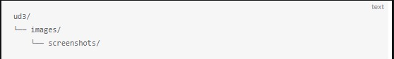
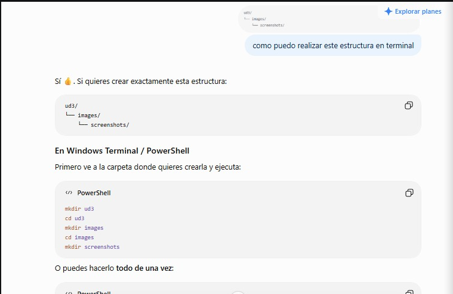
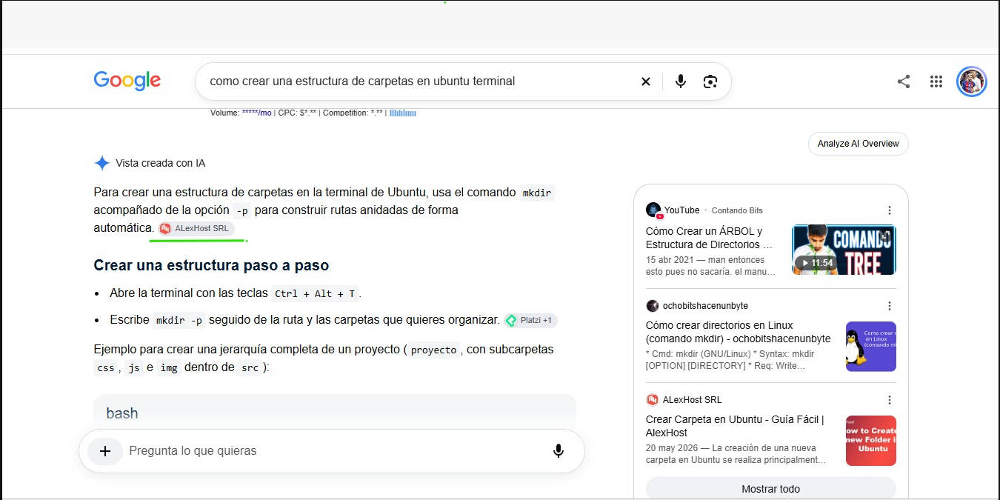
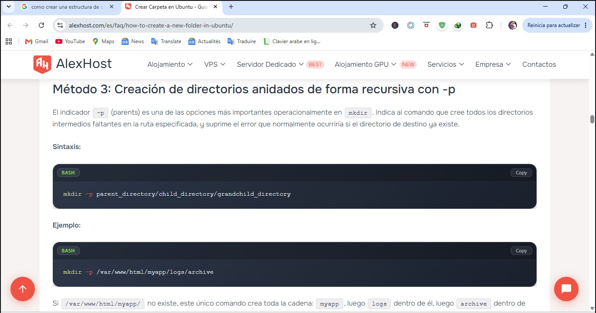
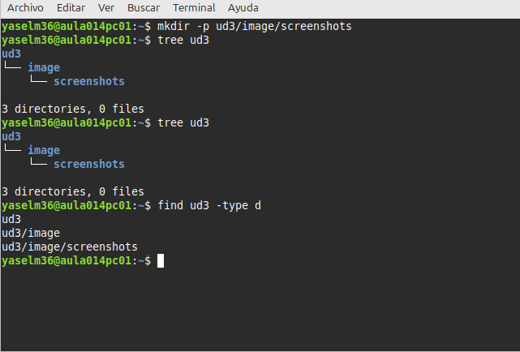

[Volver UD1. Documentación técnica](../index.md) 

 ## A2. Búsqueda de información 

**Tenemos Este Estructura y Queremos hacer Lo Mismo :**

**Y Hemos Hecho Una Busqueda En ChatGPT Y  Me Sale Esta Resulta como Puedo Hacer La :**  
 

**Y la Busqueda En Google Tambien**

**Y  La Resulta Final**
  

