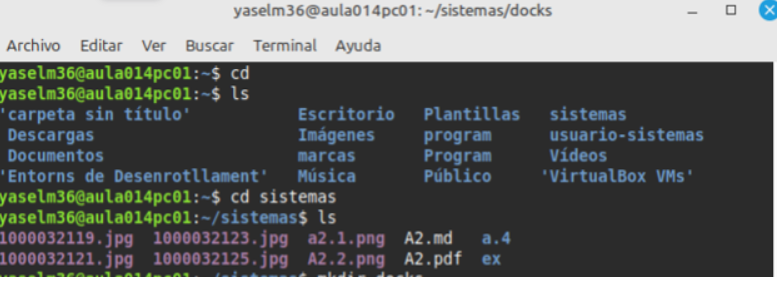
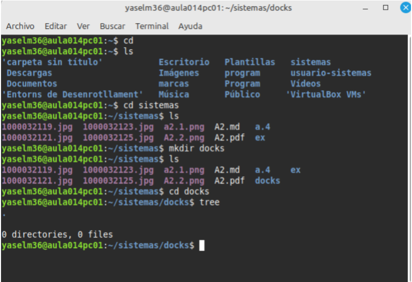
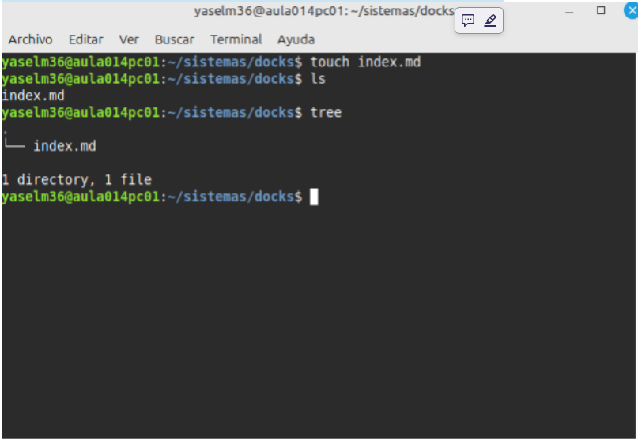
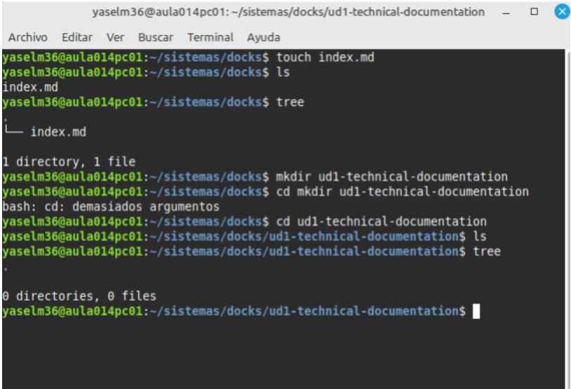

[Volver UD1. Documentación técnica](ud1-technical-documentation/index.md) 

# A3. Archivos y directorios

## 1. Preparación

**Abrimos una terminal y nos situamos en el directorio donde vamos a crear el proyecto.**

## 2. Directorio principal 

**Se ha creado el directorio principal del proyecto con el nombre dock, siguiendo la nomenclatura indicada.**

## 3. Índice principal
 
 **Se ha creado desde la terminal el archivo indicado dentro del directorio docs.**

## 4. Unidad didáctica 

**Se ha creado el directorio ud1-technical-documentation dentro de docs y, dentro de este directorio, el archivo index.md.**
 
 

 ## 5. Actividades 

 **Se han creado los cuatro directorios correspondientes a las actividades dentro de ud1-technical-documentation.**

**Dentro de cada actividad se han creado el archivo index.md y el directorio images/.**
**Finalmente, se ha comprobado la estructura creada mediante el comando tree desde el directorio docs.**