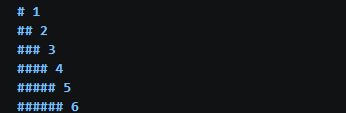
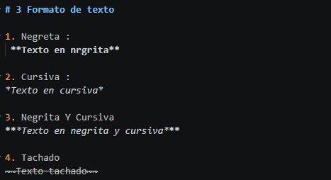
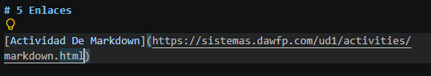
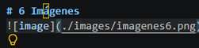
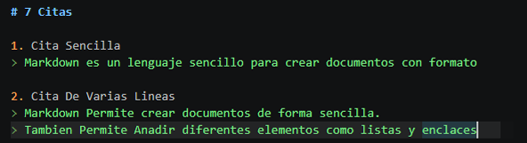
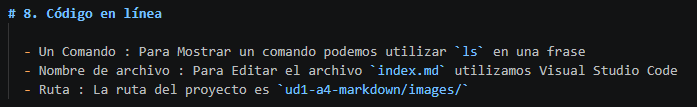
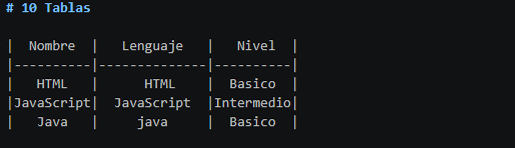
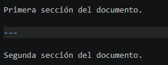
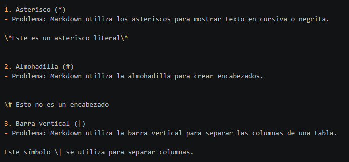

[Volver UD1. Documentación técnica](../index.md) 

# 1 Encabezados

# 1

## 2

### 3
 
#### 4

##### 5

###### 6

**Los encabezados permiten organizar el contenido de forma jerarquica.no deben utilizarse unicamente para cambiar el tamano de texto**

# 2 Párrafos

Los Parrafos Permiten Organizar un texto en diferentes bloques de contenido.

Para crear un nuevo parrafo en Markdown solamente hay que dejar una linea en blanco entre los textos.

# 3 Formato de texto

1. Negreta : **Texto en nrgrita**
2. Cursiva : _Texto en cursiva_
3. Negrita Y Cursiva ***Texto en negrita y cursiva***
4. Tachado ~~Texto tachado~~

**Codigo En Markdown :**

# 4 Listas

**Lista no Ordenada**

- HTML
- CSS
- JavaScript

**Lista Ordenada**

1. HTML
2. CSS
3. JavaScript

**Lista Anidada**

- Frontend

    - HTML
    - CSS
    - JavaScript

- Backend

    - Java
    - PHP

**Lista de tareas**

 - [X] Aprender Markdown
 - [ ] Practicar Markdown

**Codigo en Markdown es :**

# 5 Enlaces

[Actividad De Markdown](https://sistemas.dawfp.com/ud1/activities/markdown.html)

**Codigo En Markdown :**

# 6 Imágenes

El texto alternativo de una imagen sirve para describir el contenido de la imagen.

 Es útil para mejorar la accesibilidad, especialmente para las personas que utilizan lectores de pantalla.

# 7 Citas

 1. Cita Sencilla

> Markdown es un lenguaje sencillo para crear documentos con formato

2. Cita De Varias Lineas

> Markdown Permite crear documentos de forma sencilla. Tambien Permite Anadir diferentes elementos como listas y enclaces

**Codigo en Markdown es :**

# 8. Código en línea

  - Un Comando : Para Mostrar un comando podemos utilizar `ls` en una frase
  - Nombre de archivo : Para Editar el archivo `index.md` utilizamos Visual Studio Code
  - Ruta : La ruta del proyecto es `ud1-a4-markdown/images/`

**Codigo en Markdown es :**

# 9. Bloques de codigo

Los bloques de codigo permiten mostrar varias lineas de codigo

- **Bash** mkdir proyecto

cd proyecto ls

- **JavaScript** let nomber = "Yassine" Console.Log(nomber);
- **Texto sin formato**

este es un bloque de texto no se especifica ningun Lenguaje . no se aplica resultado

# 10 Tablas

| **Nombre** | **Lenguaje** | **Nivel** |
| --- | --- | --- |
| HTML | HTML | Basico |
| JavaScript | JavaScript | Intermedio |
| Java | java | Basico |

**Codigo en MarkDown :**

# 11 Línea horizontal

En Markdown podemos crear una línea horizontal para separar diferentes secciones de un documento.

Para hacerlo, debemos escribir tres guiones (---), tres asteriscos (***) o tres guiones bajos (___) en una línea independiente.

Primera sección del documento.

---

Segunda sección del documento.

**Codigo en MarkDown :**

# 12. Caracteres especiales

Algunos caracteres tienen un significado especial en Markdown, ya que se utilizan para crear elementos como títulos, enlaces o texto en negrita.

Para mostrar estos caracteres literalmente, podemos utilizar la barra invertida (\) delante del carácter. Esta técnica se conoce como escape de caracteres.

A continuación, se muestran tres ejemplos:

1. Asterisco (*)
- Problema: Markdown utiliza los asteriscos para mostrar texto en cursiva o negrita.

\*Este es un asterisco literal\*

2. Almohadilla (#)
- Problema: Markdown utiliza la almohadilla para crear encabezados.

\# Esto no es un encabezado

3. Barra vertical (|)
- Problema: Markdown utiliza la barra vertical para separar las columnas de una tabla.

Este símbolo \| se utiliza para separar columnas.

**Codigo en MarkDown :**

[Volver UD1. Documentación técnica](../index.md) 
