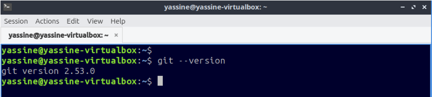
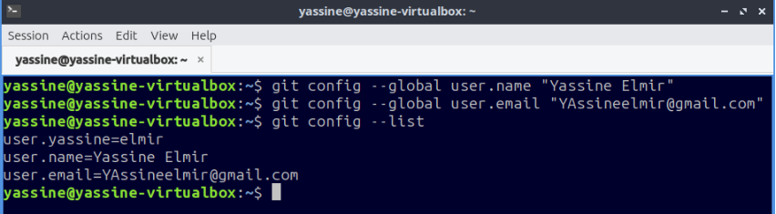
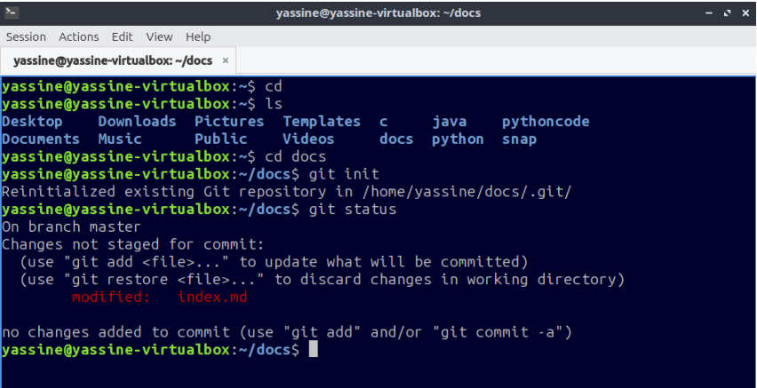
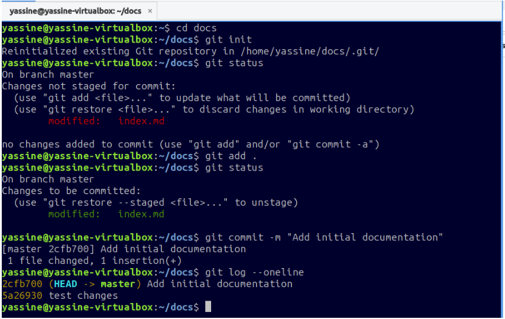

# 1. Comprobar Git 

Se puede comprobar mediante:

`git --version` Este comando muestra la versión de Git instalada en el sistema.  

Se puede consultar con:

git config user.email

El resultado muestra el correo electrónico asociado a los commits. ¿Qué ocurre si los datos no están
configurados correctamente? Se pueden configurar mediante:

`git config --global user.name "Yassine Elmir"`

`git config --global user.email "Yassineelmir@gmail.com"`

# 2. Crear el repositorio 

Crear el repositorio `usuario-sistemas/docs` Este directorio será la raíz del repositorio Git. ¿Cómo se
inicializa el repositorio?

Se utiliza: `git init`
Este comando convierte el directorio docs en un repositorio Git.

# 3. Primer commit 

¿Qué archivos no están siendo seguidos por Git? Después de ejecutar: 

`git status`

los archivos que todavía no están siendo seguidos aparecen como Untracked files. ¿Cómo se preparan todos
los archivos? 

Se utiliza:  

`git add .`

Este comando prepara todos los archivos para el siguiente commit. ¿Cuál es el mensaje del primer commit? El
primer commit se crea con:

`git commit -m "Add initial documentation"`  

¿Cómo se comprueba el estado después del commit? Se
utiliza: 

`git status`

Si todo está correcto, Git indicará que no hay cambios pendientes. ¿Cómo se consulta el historial? 

Se utiliza:

`git log --oneline`

Aquí debe aparecer el commit: Add initial documentation

# 4. Registrar cambios

¿Qué archivo se modifica? 
Se modifica el archivo:

`docs/index.md`

Se realiza una pequeña modificación y se guarda. 
¿Cómo se comprueba qué ha cambiado? 

Primero: `git status`

Después : `git diff` 

git diff permite ver las diferencias entre el estado actual del archivo y la última versión guardada en Git.

¿Cómo se prepara el archivo modificado? 

Se utiliza:  `git add index.md`

¿Cómo se crea el segundo commit? 
Se crea utilizando un mensaje descriptivo, por ejemplo:

`git commit -m "Update main documentation"`

¿Cómo se comprueba el historial? Se utiliza:

git log --oneline

El historial debe mostrar los dos commits realizados: Update main documentation Add initial documentation
