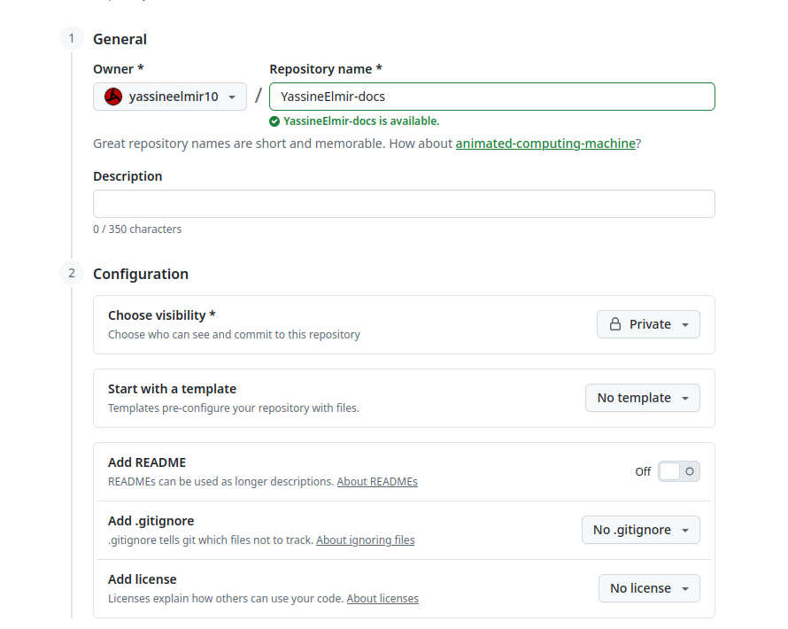
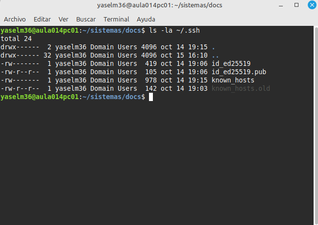
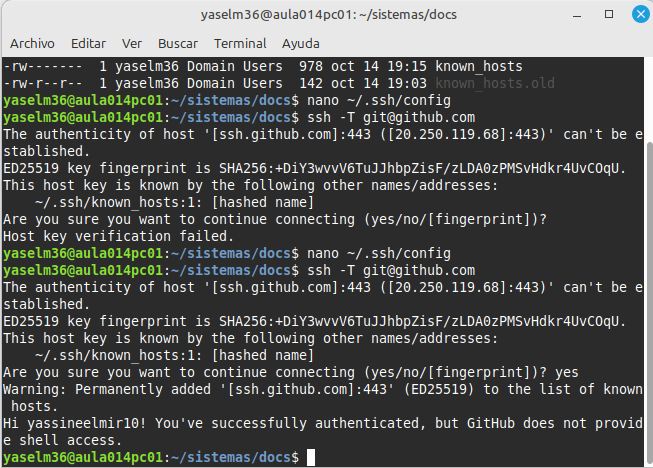
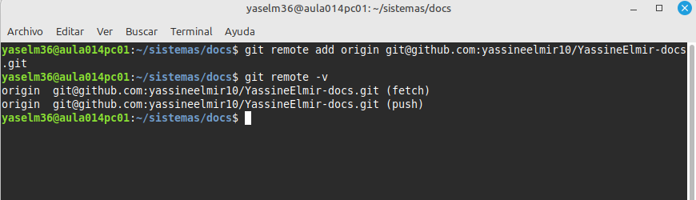
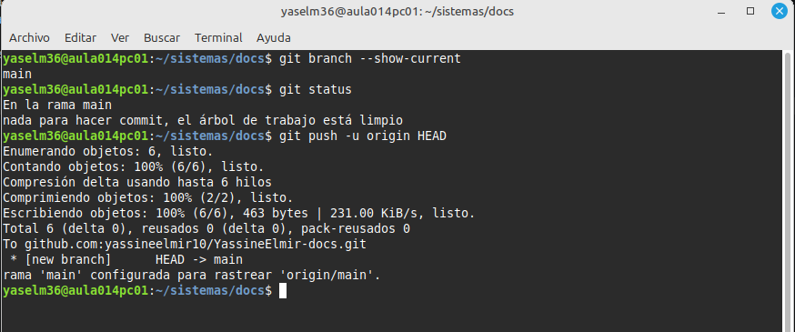
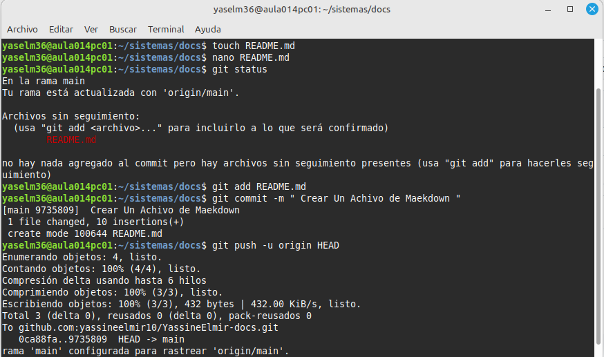
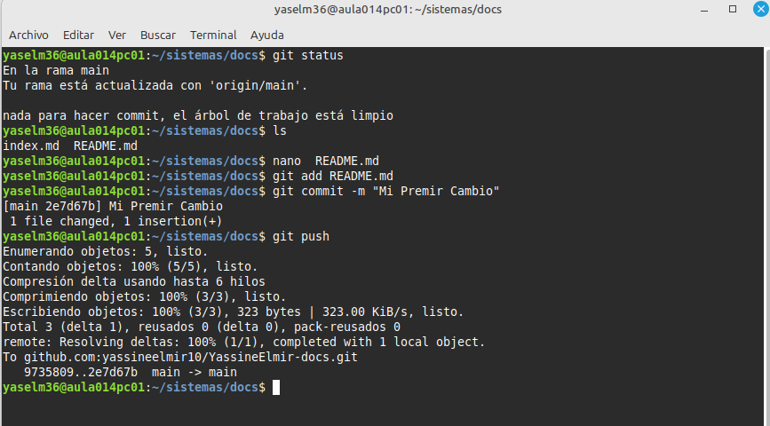
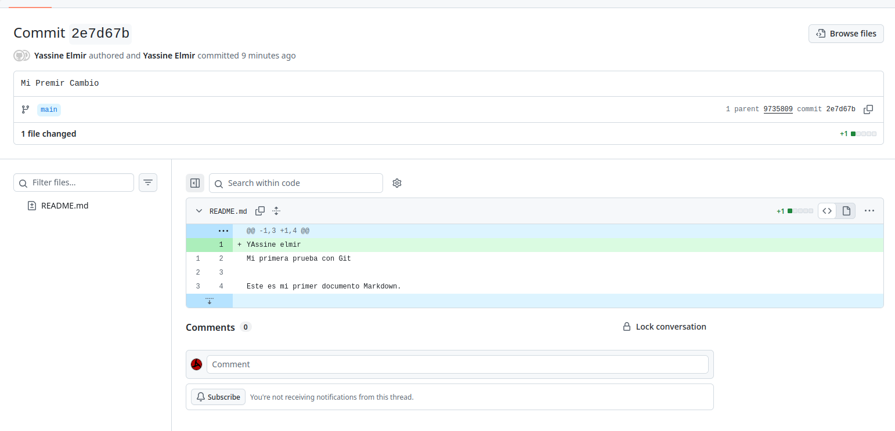

[Volver UD1. Documentación técnica](ud1-technical-documentation/indexmd) 

# A6. GitHub

# 1. Crear el repositorio remoto 

 - 1 Aqui  hemos Creado un Reposito remote 

# 2. Autenticación mediante SSH 

Para trabajar con GitHub desde la terminal utilizaremos SSH.
La primera vez que utilices GitHub mediante SSH desde un equipo, deberás comprobar que dispones de una clave SSH y asociar su clave pública a tu cuenta de GitHub.

 Para poder utilizar SSH desde la red del centro, configura la conexión con GitHub mediante el puerto 443.
Edita el archivo de configuración de SSH:
Y La hemos Hecho Eso  Abajo :  

# 3. Conectar los repositorios 

Para Conectar nuestro repositorio con nuestro ordinador local la hacemos 
asi : 

# 4. Primer push 

Y Antes de hacer push tenemos que saber que el branch premiro : 
 con `git branch --show-current`

Y tenemos que saber tambien el status de reposito como es con commando `git status`

Y tambien La estructura coincide con la existente en el repositorio local con commando `git push -u origin HEAD`

# 5. Realizar nuevos cambios 

- 1 A qui hemos creado  un archivo  se llama README.md 
y luego Hemos hecho el commando `git status` para saber si hay algo 
y hemos hecho `git add README.md`  preparar  para hacer un commit 
Y luego nos vamos a hacer un commit ` git commit -m "Crear Un Achivo de Maekdown"`
y luego un push en nuestro reposito remote con el commando `git push -u origin HEAD`

- 2 Y A qui  no vamos A hcer el pull y el commit y el push 
    
1.  vamos a cambiar algo  en nuestro  archivo 
2. preparamos el arachivo por commit 
3. hacemos el commit
4. hacemos el push con commando `git push`

# 6. Comprobar el historial

y AQui nuestro commit en github 

