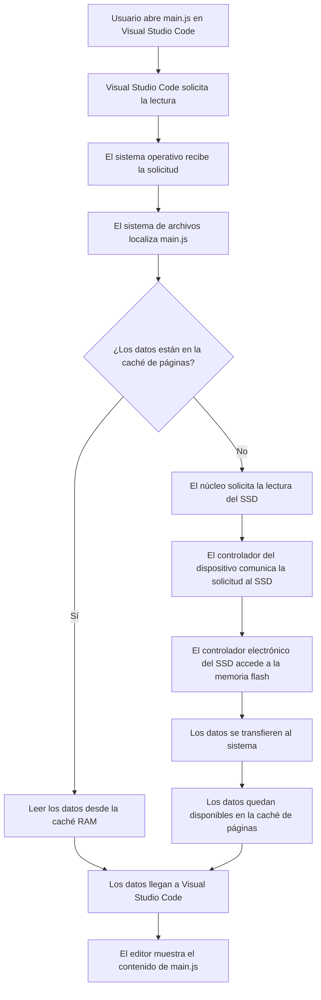

 [Volver ](../index2.md)

# A1. Sistemas informáticos e información

# Hardware y software 

| Elemento | Hardware / Software |
|---|---|
| Procesador | Hardware |
| Ubuntu | Software |
| Memoria RAM | Hardware |
| Visual Studio Code | Software |
| Disco SSD | Hardware |
| Navegador Firefox | Software |
| Tarjeta gráfica | Hardware |
| Controlador de impresora | Software |
| Placa base | Hardware |
| LibreOffice | Software |

> Preguntas

1. **¿Puede funcionar un ordenador sin un sistema operativo instalado? Justifica tu respuesta.**

Sí. Un ordenador puede encenderse y ejecutar ciertos programas sin un sistema operativo, por ejemplo, mediante un firmware o un programa específico. Sin  embargo, no podría utilizar normalmente las funciones de un sistema operativo como Ubuntu para gestionar aplicaciones, archivos y recursos del equipo.

2. **¿Por qué un programa necesita hardware para ejecutarse?**

    Porque el hardware proporciona los recursos físicos necesarios para ejecutar las instrucciones del programa, almacenar los datos y mostrar los resultados. Por ejemplo, el procesador ejecuta las instrucciones y la memoria RAM mantiene temporalmente los datos que se están utilizando.

3. **¿Qué diferencia existe entre un sistema operativo y una aplicación?**

    El sistema operativo administra los recursos del ordenador y proporciona servicios a las aplicaciones. Una aplicación está diseñada para realizar tareas específicas, como navegar por Internet con Firefox o editar documentos con LibreOffice.

4. **¿Qué papel desempeñan los recursos humanos dentro de un sistema informático?**

     Las personas utilizan, administran, desarrollan y mantienen el sistema informático. También introducen datos, interpretan los resultados y se encargan de resolver problemas y tomar decisiones
 
 # 2. Capas de un sistema informático 

 | Capa | Elementos y operaciones |
|---|---|
| Dispositivos físicos | Procesador (CPU), memoria RAM, disco duro, teclado, ratón y pantalla. |
| Microarquitectura | Registros, ALU (unidad aritmético-lógica), unidad de control y ejecución de instrucciones. |
| Lenguaje máquina | Instrucciones binarias (0 y 1), operaciones aritméticas y lógicas que ejecuta el procesador. |
| Sistema operativo | Gestiona los recursos del ordenador, la memoria, los procesos, los archivos y los dispositivos. |
| Programas de sistema | Controladores (drivers), compiladores, intérpretes, utilidades de sistema y herramientas de administración. |
| Programas de usuario | Aplicaciones como navegadores web, editores de texto, videojuegos y programas de ofimática. |

Preguntas
1. **¿Qué funciones desempeña Firefox durante la descarga?**

      Firefox solicita la página web, recibe los datos a través de la red, interpreta el contenido recibido y gestiona la descarga. Después, solicita al sistema operativo que guarde el archivo en la ubicación elegida.

2. **¿Qué operaciones realiza el sistema operativo para guardar el archivo?**

      El sistema operativo comprueba los permisos, administra los recursos necesarios, crea o abre el archivo, escribe los datos y actualiza la información del sistema de archivos para que pueda localizarse posteriormente.

3. **¿Por qué Firefox no necesita conocer el funcionamiento electrónico del SSD?**

      Porque Ubuntu proporciona interfaces de acceso a los archivos y utiliza los controladores necesarios para comunicarse con el dispositivo. Firefox trabaja con rutas y operaciones de lectura y escritura, sin controlar directamente los circuitos del SSD.

4. **¿Qué ventajas proporciona esta organización por capas a los desarrolladores de aplicaciones?**

- Simplifica el desarrollo de aplicaciones.
- Oculta los detalles internos del hardware.
- Facilita el mantenimiento y la detección de errores.
- Permite utilizar las mismas interfaces con diferentes dispositivos compatibles.
- Mejora la reutilización del software

# 3. Datos, información y tipos de datos 

## Apartado A. Datos e información

| Ejemplo | Dato / Información |
|---|---|
| `38` | Dato aislado |
| La temperatura del procesador es de 38 °C. | Información contextualizada |
| `192.168.1.10` | Dato aislado |
| La dirección IP del equipo es `192.168.1.10`. | Información contextualizada |
| `85` | Dato aislado |
| El disco SSD tiene un 85 % de ocupación. | Información contextualizada |

> Preguntas
1. **¿Por qué un mismo dato puede tener diferentes significados?**

   Porque un dato aislado no siempre contiene suficiente contexto. Por ejemplo, el número 38 puede representar una temperatura, una edad o una cantidad, dependiendo de la situación.

2. **¿Qué información adicional necesitarías para interpretar correctamente el valor 120?**

   Necesitaría conocer qué representa el valor, su unidad de medida, el objeto al que se refiere y el contexto en el que se ha obtenido. Por ejemplo, podría representar 120 segundos, 120 °C o 120 archivos.

  **Apartado B. Tipos de datos**

     Para esta actividad clasificamos los datos numéricos, alfabéticos y alfanuméricos según los caracteres que contienen y su función.

| Dato | Tipo | Justificación |
|---|---|---|
| 2026 | Numérico | Contiene cifras y puede representar un número o un año. |
| Ubuntu | Alfabético | Contiene letras. |
| DAW1 | Alfanumérico | Contiene letras y números. |
| 192.168.1.10 | Alfanumérico | Es una dirección IP con cifras y puntos; se interpreta como un identificador, no como un número decimal. |
| Firefox | Alfabético | Contiene letras. |
| PC-01 | Alfanumérico | Contiene letras, cifras y un guion. |
| 3.14 | Numérico | Representa un número decimal. |
| Aula | Alfabético | Contiene letras. |

1. **¿Qué diferencia existe entre un dato fijo y uno variable?**

   Un dato fijo mantiene el mismo valor durante el contexto considerado, mientras que un dato variable puede cambiar durante la ejecución del programa o a lo largo del tiempo.

2. **Indica un ejemplo de dato fijo y otro variable en una aplicación informática.**

- Dato fijo: el nombre de una aplicación, como MiCalculadora.
- Dato variable: el número que introduce el usuario para realizar una operación matemática

# 4 Tratamiento de la información

En el tratamiento de la información distinguimos cuatro operaciones:
- **Entrada**: los datos que recibe el sistema.
- **Procesamiento**: las operaciones que realiza sobre esos datos.
- **Salida**: los resultados que presenta o envía.
- **Almacenamiento**: la conservación de los datos en una memoria o dispositivo

| Operación | A. Búsqueda de archivos | B. Cámara digital | C. Navegador web |
|---|---|---|---|
| Entrada | El nombre del archivo introducido por el usuario. | La luz captada por el sensor de la cámara y las órdenes del usuario. | La dirección web introducida por el usuario y los datos recibidos de la red. |
| Procesamiento | El sistema compara el criterio de búsqueda con los nombres de archivos y prepara los resultados. | El dispositivo procesa la señal del sensor y genera la imagen digital. | El navegador solicita la página, interpreta HTML, CSS y JavaScript, y representa el contenido. |
| Salida | La lista de archivos encontrados en pantalla. | La fotografía mostrada en la pantalla. | La página web representada en pantalla. |
| Almacenamiento | No es necesario guardar permanentemente los resultados de la búsqueda. | La fotografía se guarda en la memoria del teléfono si el usuario decide conservarla. | La página puede mantenerse temporalmente en memoria o caché; no es obligatorio guardarla como archivo permanente. |

> Preguntas
1. **¿Qué diferencia existe entre procesar información y almacenarla?**

Procesar información consiste en realizar operaciones sobre los datos, como ordenarlos, compararlos o transformarlos. Almacenarla consiste en conservarla para poder utilizarla posteriormente.

2. **¿Puede un sistema informático realizar operaciones de procesamiento sin mostrar inmediatamente los resultados al usuario? Pon un ejemplo.**

   Sí. Por ejemplo, un sistema puede realizar una copia de seguridad en segundo plano, comprimiendo y guardando archivos sin mostrar continuamente los resultados en pantalla

   # 5 Representación digital de una imagen

Cada píxel ocupa un bit: `0` representa el blanco y `1` representa el negro.

**Apartado A. Interpretación de una imagen**
La secuencia es:

`0110 1001 1001 0110`

Separamos los 16 bits en cuatro filas de cuatro píxeles

0 1 1 0    
1 0 0 1   
1 0 0 1     
0 1 1 0 

**Apartado B. Creación de una imagen**

Vamos a diseñar una imagen sencilla con forma de cruz negra sobre fondo blanco

.png)

0 1 0 0    
1 1 1 1   
0 1 0 0    
0 1 0 0

Secuencia binaria de 16 bits :

`0100 1111 0100 0100`

**Apartado C. Análisis**

**1. ¿Cuántos píxeles tiene la imagen?**

             Tiene 4 x 4 = 16 píxeles.

**2. ¿Cuántos bits se necesitan para representarla?**

Se necesitan 16 bits, porque cada píxel ocupa exactamente un bit.

**3. ¿Cuántos bytes ocupa la representación de los píxeles, sin contar información adicional?**

Un byte equivale a 8 bits:

                    
                  16 / 8 = 2 bytes

La representación ocupa **2 bytes**

**4. ¿Cuántas imágenes diferentes pueden representarse con 16 píxeles si cada uno puede ser blanco o negro?**

Cada píxel tiene dos posibilidades. Por tanto :

                    2^16 = 65 536

Se pueden representar 65.536 imágenes diferentes.

5. ¿Qué limitaciones tendría este sistema para representar fotografías reales?
- Solo permite dos colores: blanco y negro.
- La resolución es muy baja, con solo 16 píxeles.
- No permite representar tonos de gris ni colores.
- No puede mostrar detalles complejos de una fotografía real.

# 6. Investigación sobre el acceso a archivos

**Apartado A. Investigación de conceptos**

Cuando abrimos main.js desde Visual Studio Code en Ubuntu, intervienen varios componentes que permiten localizar el archivo, leer sus datos y mostrarlos en el editor.

| Concepto | Descripción y función durante la lectura de `main.js` |
|---|---|
| Biblioteca de software | Conjunto de funciones reutilizables. Visual Studio Code y sus componentes pueden utilizar bibliotecas para facilitar operaciones de lectura y gestión de archivos. |
| Llamada al sistema (system call) | Mecanismo mediante el cual una aplicación solicita un servicio al núcleo del sistema operativo. Por ejemplo, puede solicitar abrir un archivo o leer sus datos. |
| Núcleo del sistema operativo (kernel) | Parte central del sistema operativo. Gestiona procesos, memoria, permisos y operaciones de entrada y salida necesarias para acceder al archivo. |
| Sistema de archivos | Organiza archivos y directorios. Permite localizar `main.js` mediante su ruta y obtener la información necesaria para acceder a su contenido. |
| Controlador de dispositivo (driver) | Software que permite al sistema operativo comunicarse con un dispositivo de hardware, como una unidad SSD. |
| Caché de páginas (page cache) | Memoria gestionada por el sistema operativo que mantiene temporalmente páginas de datos de archivos para acelerar accesos posteriores. |
| Controlador electrónico del SSD | Electrónica interna del SSD que gestiona operaciones sobre la memoria flash, incluida la traducción de direcciones y la gestión del almacenamiento. |
| Memoria flash | Memoria no volátil donde el SSD conserva los datos incluso cuando el ordenador está apagado. Allí se encuentran almacenados los datos persistentes del archivo. |

**Apartado B. Aplicaciones y sistema operativo**

**1. ¿Qué diferencia existe entre una función de una biblioteca de software y una llamada al sistema?**

Una función de biblioteca es una función reutilizable que puede facilitar una operación de programación. Una llamada al sistema permite solicitar directamente un servicio al núcleo del sistema operativo.

Por ejemplo, una biblioteca puede proporcionar una función para leer un archivo y, en su implementación, utilizar llamadas al sistema como open() y read() en Linux.

**2. ¿Qué función desempeña el núcleo del sistema operativo durante la lectura de un archivo?**

El núcleo comprueba los permisos de acceso, coordina la lectura, gestiona la memoria y utiliza los componentes adecuados para obtener los datos del archivo.

**3. ¿Por qué una aplicación no accede normalmente de forma directa al hardware del SSD?**

Porque el sistema operativo ofrece una interfaz común y controla el acceso a los dispositivos. Así se mejora la seguridad, se evitan conflictos entre aplicaciones y se ocultan los detalles específicos del hardware.

**4.Qué ventajas tiene para los desarrolladores utilizar las interfaces proporcionadas por el sistema operativo?**
- Simplifican el desarrollo.
- Evitan tener que controlar directamente el hardware.
- Facilitan la compatibilidad con distintos dispositivos.
- Permiten gestionar los permisos de acceso.
- Mejoran el mantenimiento y la seguridad del software

**Apartado C. Memoria y almacenamiento**
   
**1. ¿Cómo localiza el sistema operativo los datos de un archivo a partir de su nombre y ruta?**

El sistema operativo interpreta la ruta, recorre los directorios necesarios y consulta las estructuras del sistema de archivos para localizar el archivo y sus datos. Por ejemplo, al abrir /home/usuario/proyecto/main.js, debe resolver cada componente de esa ruta.

**2. ¿Qué es la caché de páginas y para qué se utiliza?**

Es una zona de memoria RAM que conserva temporalmente los datos de archivos. Su objetivo es reducir las lecturas repetidas del almacenamiento y mejorar el rendimiento.

**3. ¿Qué ocurre si el contenido del archivo ya se encuentra en la caché de páginas?**

El sistema operativo puede obtener los datos desde la memoria RAM, sin necesidad de leerlos de nuevo físicamente desde el SSD. Esto normalmente reduce el tiempo de acceso.

**4. ¿Qué ocurre si es necesario recuperar los datos físicamente del SSD?**

El sistema operativo solicita la lectura mediante su sistema de almacenamiento y los controladores correspondientes. El SSD recupera los datos de su memoria flash y los transfiere al sistema. Los datos pueden quedar en la caché de páginas para futuros accesos.

**5. ¿Qué diferencia existe entre el controlador de dispositivo del sistema operativo y el controlador electrónico del SSD?**

El controlador de dispositivo es software que se ejecuta en el sistema y permite comunicarse con el hardware. El controlador electrónico es un componente físico integrado en el SSD que gestiona sus operaciones internas de almacenamiento.

**Apartado D. Representación del proceso**
El siguiente diagrama Mermaid muestra los dos caminos posibles: leer desde la caché de páginas o recuperar los datos del SSD

### Apartado D. Representación del proceso

**Explicación del diagrama :**

1. El usuario abre main.js en Visual Studio Code.
2. La aplicación solicita al sistema operativo acceder al archivo.
3. El sistema de archivos localiza el archivo y comprueba los permisos correspondientes.
4. El sistema operativo comprueba si los datos están disponibles en la caché de páginas.
5. Si están disponibles, los obtiene desde la RAM.
6. Si no están disponibles, solicita una lectura al SSD mediante las capas de almacenamiento y los controladores.
7. Los datos recuperados pueden quedar almacenados en la caché de páginas.
8. Finalmente, Visual Studio Code recibe los datos y muestra el contenido del archivo.
El diagrama representa el flujo lógico simplificado. En una implementación real, algunos pasos internos pueden variar y el sistema operativo puede utilizar mecanismos adicionales de caché y entrada/salida

**Apartado E. Fuentes consultadas**

Estas son fuentes técnicas oficiales que puedes incluir en el repositorio para documentar la investigación.

**1.Explica las estructuras del sistema de archivos y la gestión de la caché de páginas** 
Linux Kernel Documentation — Overview of the Linux Virtual File System.
[Consultar documentacion de los controladores](https://docs.kernel.org/filesystems/vfs.html?utm_source=chatgpt.com)

**2.Documentación sobre las interfaces y los mecanismos utilizados para desarrollar controladores de dispositivos** Linux Kernel Documentation — Driver implementer's API guide.
[Consultar documentación de los controladores](https://docs.kernel.org/driver-api/index.html?utm_source=chatgpt.com)

**3. Manual de la llamada al sistema que permite abrir archivos y obtener un descriptor de archivo** 
Linux man-pages 
[Consultar open](https://man7.org/linux/man-pages/man2/open.2.html?utm_source=chatgpt.com)

**4.Manual de la llamada al sistema que permite leer datos desde un descriptor de archivo.**
Linux man-pages 
[Consultar read](https://man7.org/linux/man-pages/man2/read.2.html?utm_source=chatgpt.com)

**4.Explica cómo el núcleo organiza y envía solicitudes de entrada/salida a dispositivos de almacenamiento.**
Linux Kernel Documentation — Multi-Queue Block IO Queueing Mechanism.
[Consultar documentación de blk-mq](https://docs.kernel.org/block/blk-mq.html?utm_source=chatgpt.com)

 [Volver ](../index2.md)
