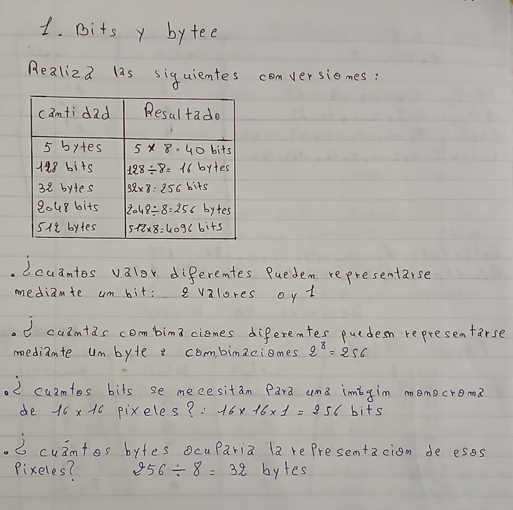
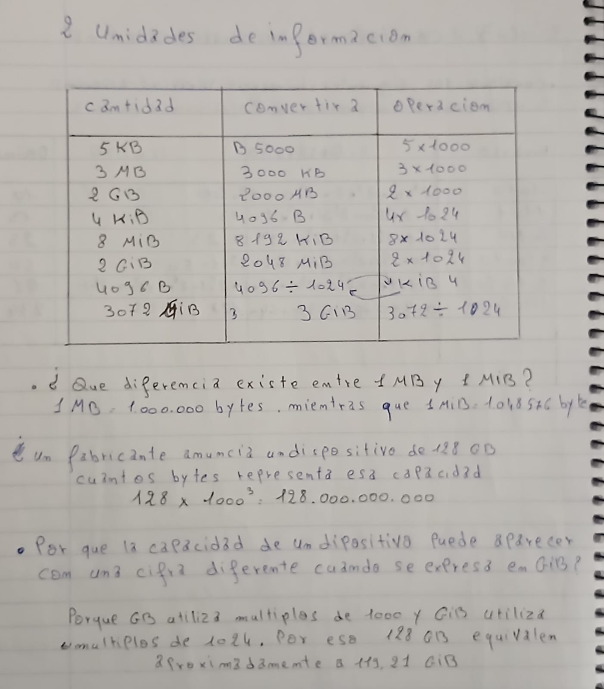
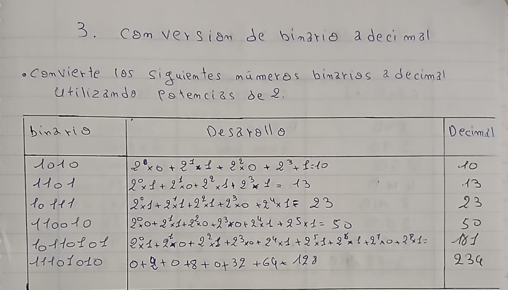
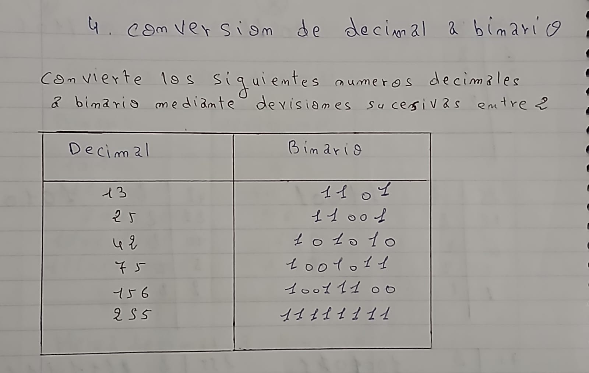
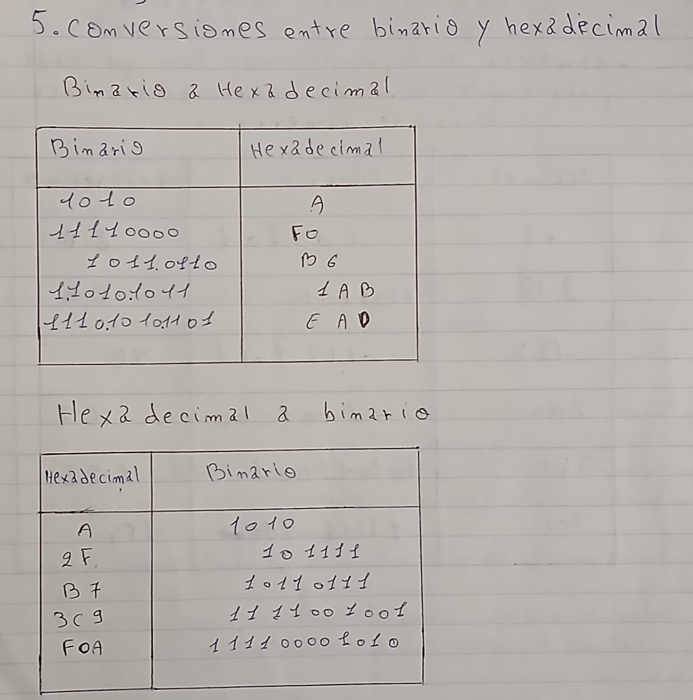
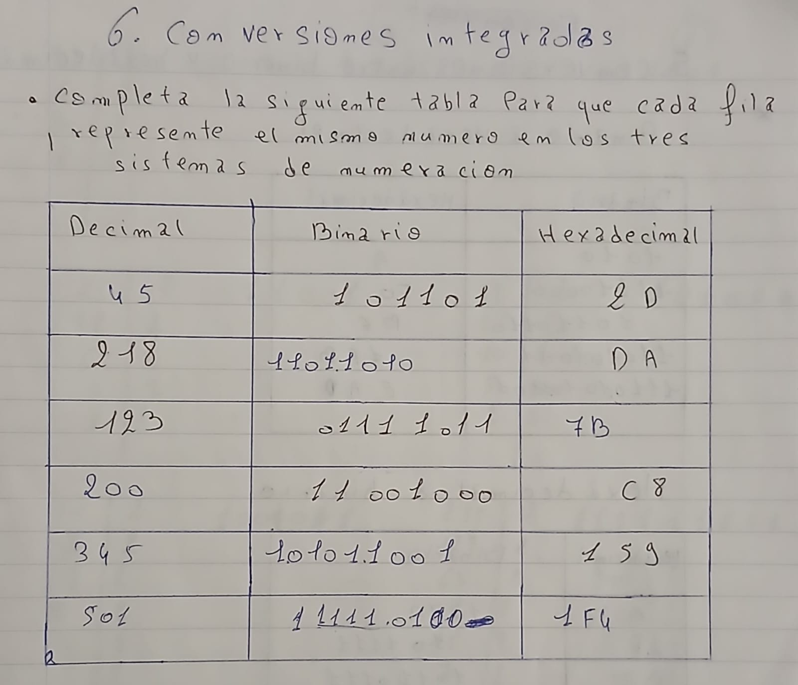

# A2. Representación de la información

## 1. Bits y bytes 

## 2. Unidades de información

## 3. Conversión de binario a decimal

## 4. Conversión de decimal a binario

## 5. Conversiones entre binario y hexadecimal

## 6. Conversiones integradas
 
 