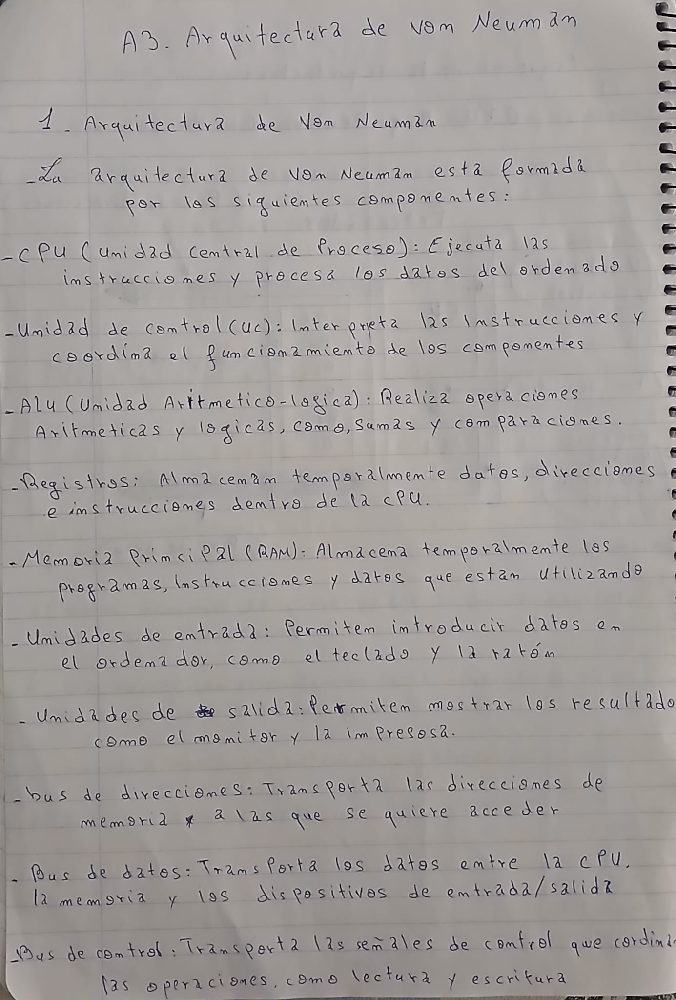
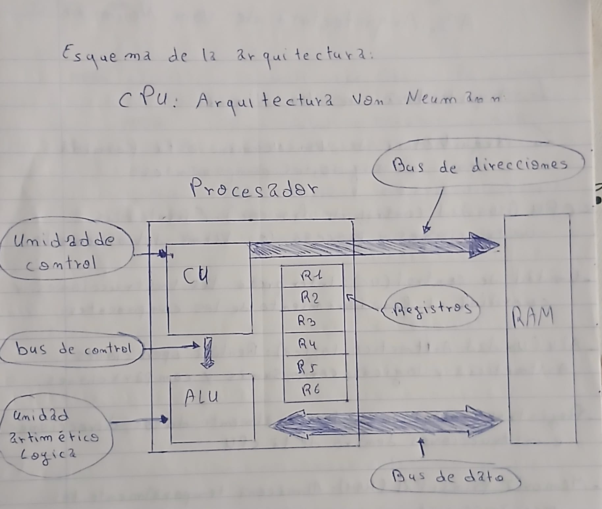
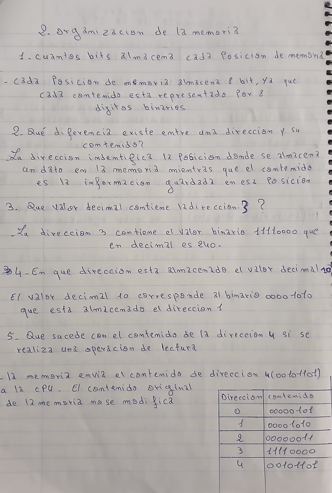
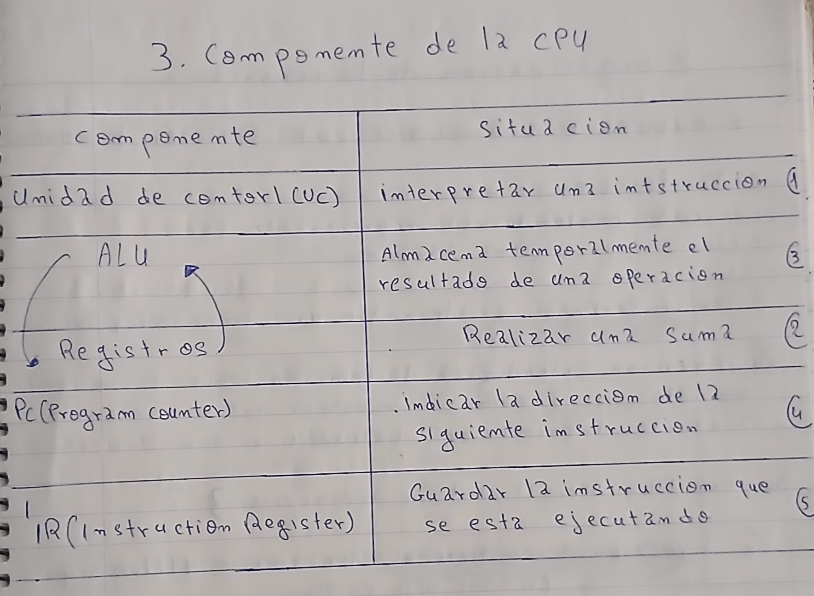
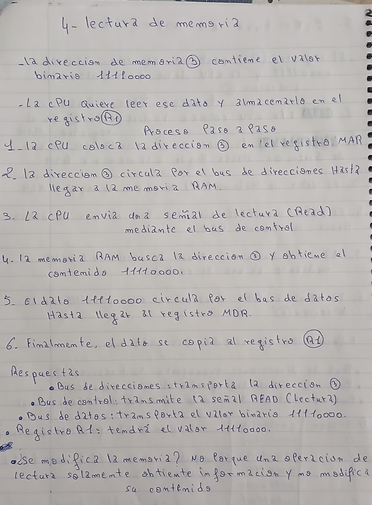
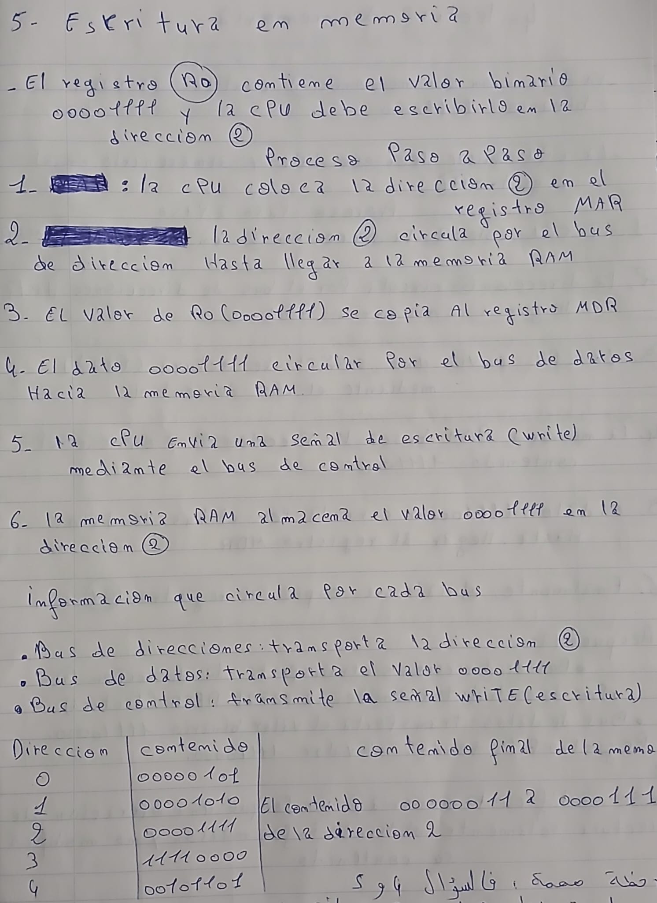

[Volver ](../index2.md)

# 1. Arquitectura de Von Neumann

# 2. Organización de la memoria

# 3. Componentes de la CPU

# 4. Lectura de memoria

# 5. Escritura en memoria

[Volver ](../index2.md)