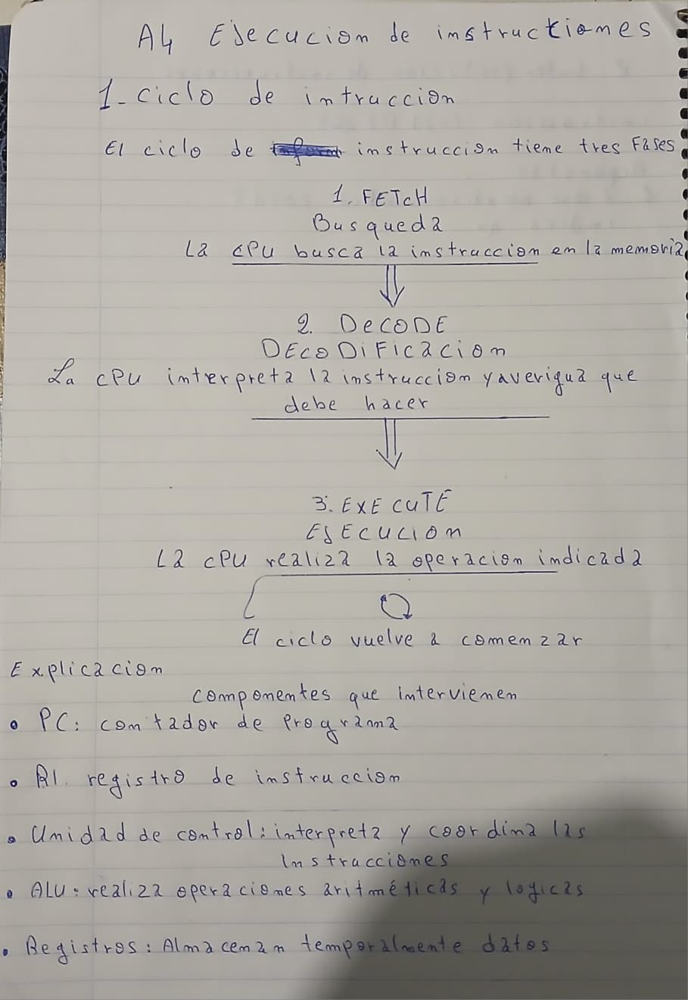
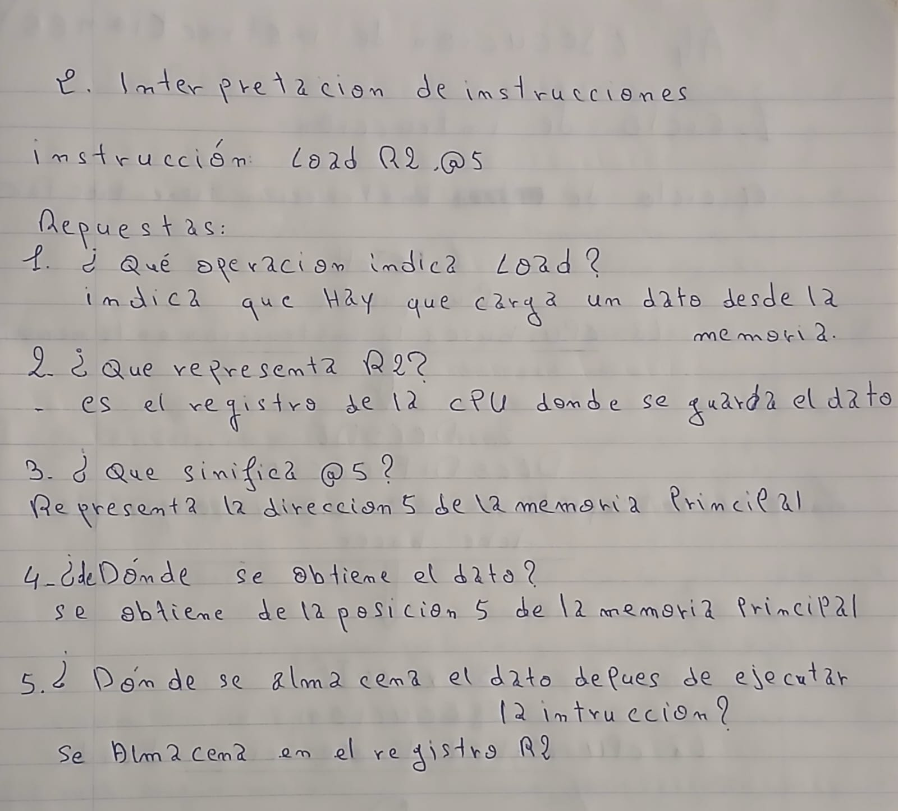
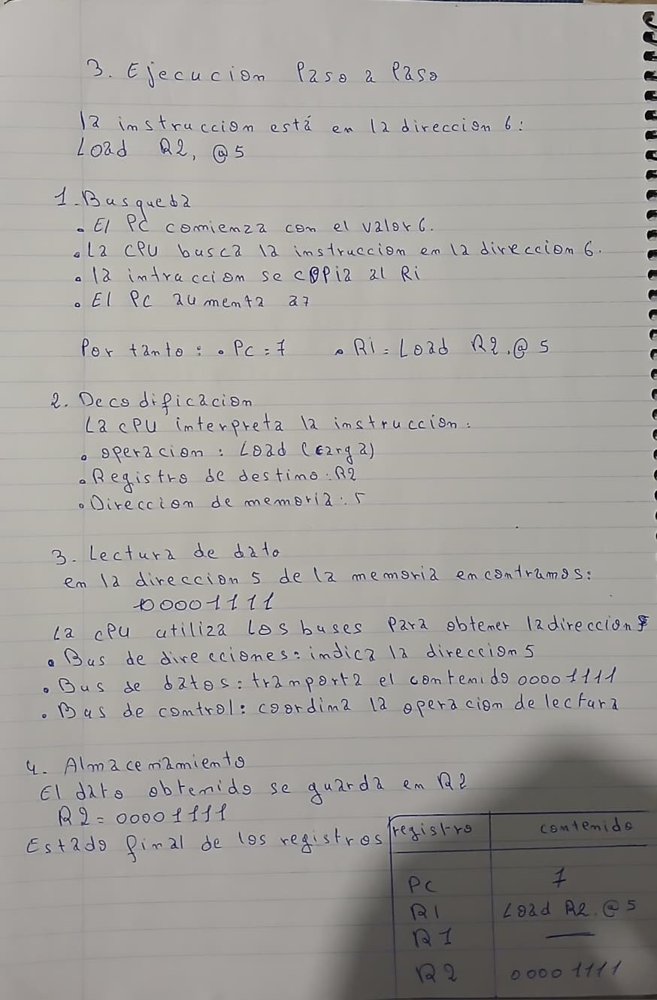
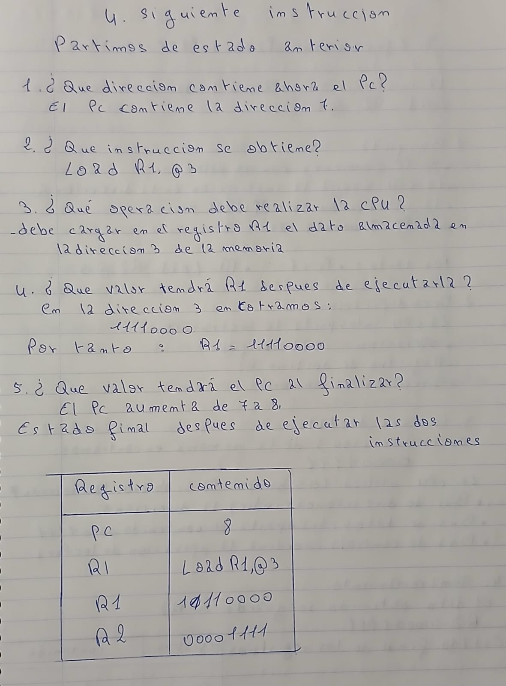
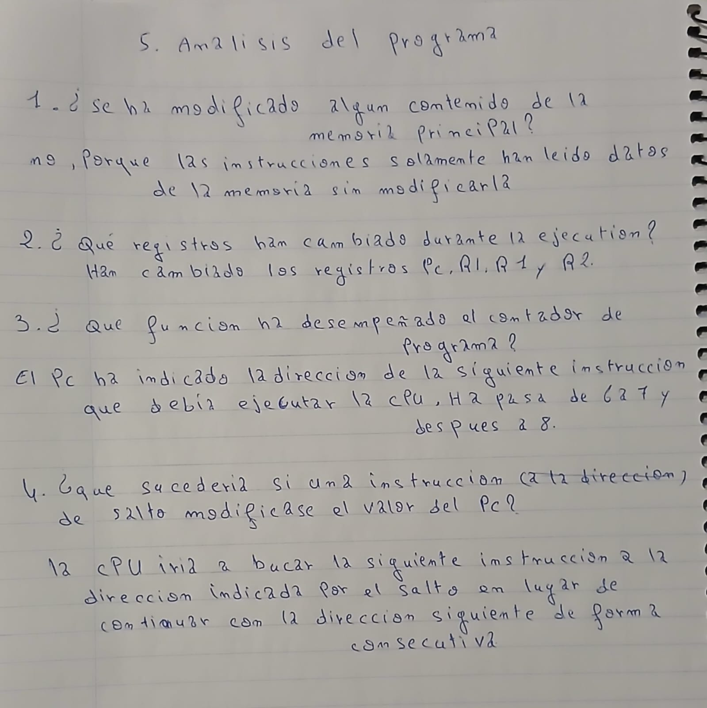

[Volver ](../index2.md)  

# A4. Ejecución de instrucciones

## 1. Ciclo de instrucción

## 2. Interpretación de instrucciones

## 3. Ejecución paso a paso

## 4. Siguiente instrucción

## 5. Análisis del programa

[Volver ](../index2.md)