# B2-A1. Arquitectura del procesador y compilación de un programa en C 

# 1. Identificar la arquitectura del procesador 

- Abremos una terminal de Linux y ejecutamos :

`uname -m`

Este comando muestra la arquitectura de la máquina sobre la que se está ejecutando Linux.

Algunos resultados habituales son:

- `x86_64` : Arquitectura x86 de 64 bits, utilizada por procesadores Intel y AMD.
-  `aarch64` : Arquitectura ARM de 64 bits.

Y aqui tenemos el resultado :
 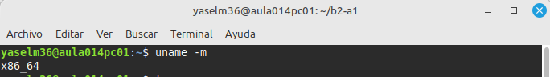

### 1.2. Información del procesador

Ejecutamo también :

`lscpu`

Este comando muestra información detallada sobre el procesador.

**Los datos obtenidos son:**

- Arquitectura: x86_64.

- Fabricante: Intel (GenuineIntel).

- Modelo del procesador: Intel Core i5-9500 CPU @ 3.00 GHz.

- Número de CPU lógicas: 6.

- Número de sockets: 1.

- Núcleos por socket: 6.

- Hilos por núcleo: 1.

### 1.3. Cálculo de las CPU lógicas

Para comprobar el número de CPU lógicas, utilizamos la siguiente fórmula:

CPU lógicas = Sockets × Núcleos por socket × Hilos por núcleo

Sustituyendo los valores obtenidos:

1 × 6 × 1 = 6

El resultado calculado es de 6 CPU lógicas.

Este resultado coincide con las 6 CPU lógicas que muestra el comando lscpu.

Por tanto, podemos confirmar que la relación entre sockets, núcleos e hilos es correcta en nuestro sistema.

Y aqui tenemos la captura :
 
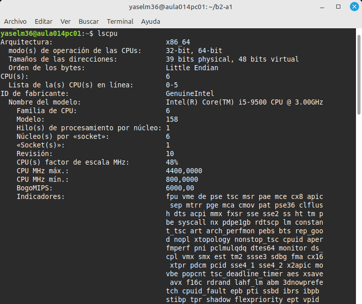

# 2. Preparar el entorno de trabajo 

En primer lugar, tenemos que compruebar si tienemos instalado el compilador GCC:

Y vamos A probar con el commando `gcc --version`

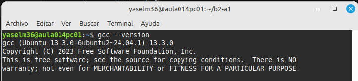

Y en este captura mostra que tenemos el compilador gcc instalado.

Compruebamos también que están disponibles las herramientas que utilizaremos posteriormente:

con los commandos : 
 
 `objdump --version`   
 `objcopy --version`  
 `xxd -v` 

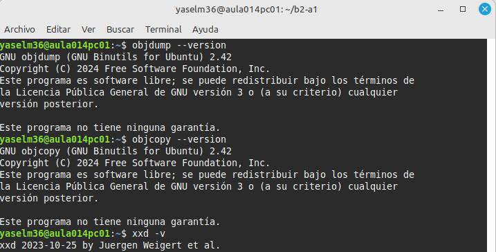

Y los capturas muestran que tenemos las herramientas .

Desde la terminal, sitúatemos en tu directorio de trabajo y creamos un directorio llamado b2-a1:

`mkdir b2-a1` 
`cd b2-a1`  

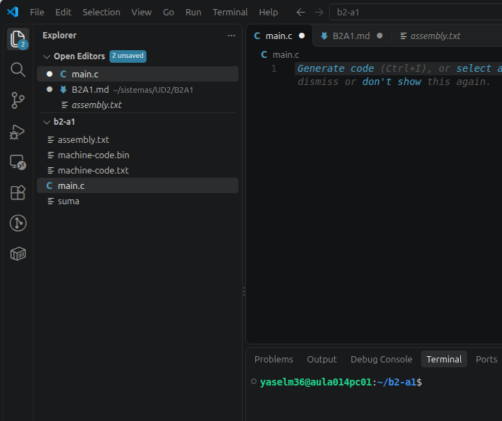

Y ahora estamos en dentro del visual studio code y tenemos el directorio creado 

## 3. Crear un programa en C 

### 3.1. Creación del archivo main.c

Desde Visual Studio Code, he creado un archivo llamado main.c dentro del directorio b2-a1.

He introducido un programa escrito en lenguaje C que solicita dos números enteros al usuario, calcula su suma y muestra el resultado por pantalla.

### 3.2. Funcionamiento del programa

El programa realiza las siguientes operaciones:

1. Declara tres variables enteras: num1, num2 y suma.

2. Solicita al usuario el primer número mediante printf().

3. Lee el primer número utilizando scanf().

4. Solicita y lee el segundo número.

5. Suma los dos valores y almacena el resultado en la variable suma.

6. Muestra el resultado por pantalla.

7. Finaliza correctamente mediante return 0.

Código fuente completo del archivo main.c abierto en Visual Studio Code.

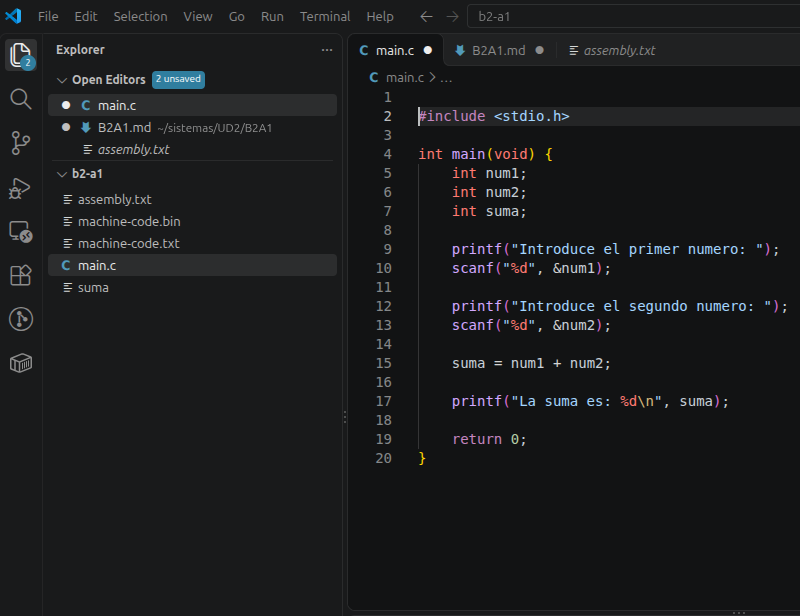

## 4. Compilar el programa 

Para compilar el programa, he abierto la terminal integrada de Visual Studio Code y he ejecutado el siguiente comando: 

`gcc -O0 main.c -o suma`

Este comando utiliza el compilador GCC para transformar el código fuente main.c en un archivo ejecutable llamado suma.

La opción -O0 desactiva las optimizaciones del compilador para facilitar el análisis posterior del código generado.

Y Aqui tenemos el resultado :

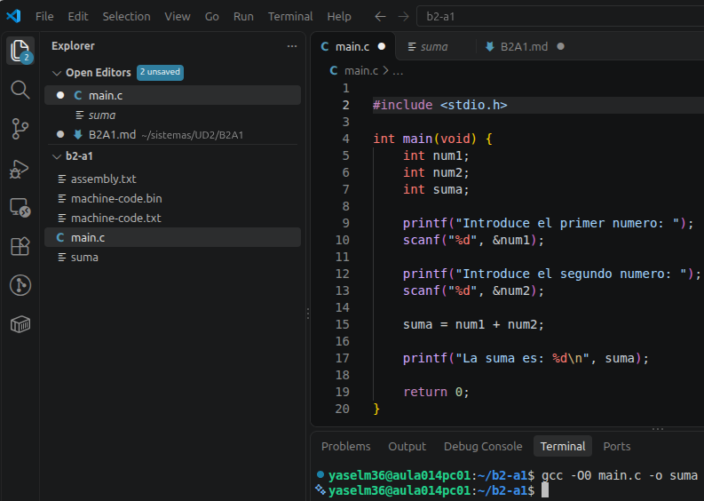

Después de la compilación, he ejecutado el siguiente comando:

`ls -l`

El resultado permite comprobar que existen los siguientes archivos:

main.c: contiene el código fuente escrito en lenguaje C.

suma: es el programa ejecutable generado por GCC.

La compilación se ha realizado correctamente si no aparecen errores y se genera el archivo ejecutable suma.

Y aqui temos el resultado : 

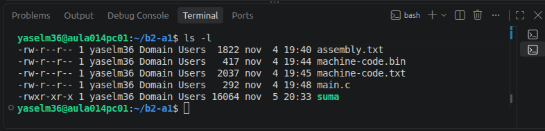

## 5. Ejecutar el programa

Desde la misma terminal, ejecutamos :

`./suma`

He realizado tres ejecuciones con diferentes parejas de números para comprobar el funcionamiento del programa.

Prueba 1: Números positivos

Primer número: 5

Segundo número: 3

Resultado: 8

Prueba 2: Números negativos

Primer número: -4

Segundo número: -10

Resultado: -14

Prueba 3: Números diferentes

Primer número: 12

Segundo número: 20

Resultado: 32

En las tres pruebas, el programa ha realizado correctamente las operaciones y ha mostrado los resultados esperados.

* Y Aqui tenemos la captura  de ejecutacion en terminal : 

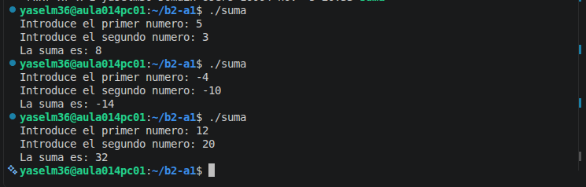

Para conocer el tipo de archivo generado por el compilador, he ejecutado el siguiente comando:

`file suma`

Este comando muestra información sobre el archivo ejecutable, incluyendo su formato y arquitectura.

Y Aqui el resultado :

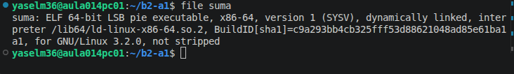

**Para consultar el tamaño de ambos archivos, he utilizado:**

`ls -lh main.c suma`

El resultado permite comparar el tamaño del código fuente y del archivo ejecutable.

Tamaño de main.c: **-rw-r--r-- 1 yaselm36 Domain Users 292 nov  4 19:48 main.c**

Tamaño de suma: **-rwxr-xr-x 1 yaselm36 Domain Users 16K nov  5 20:33 suma**
 
 Y aqui tenemos la captura : 

 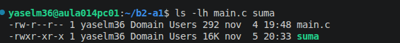

 ## 7. Examinar el código ensamblador 

## 7.1. Obtener el código ensamblador 

Para examinar las instrucciones generadas por el compilador GCC, he ejecutado el siguiente comando:

`objdump -d -M intel --no-show-raw-insn --disassemble=main suma > assembly.txt`

Este comando desensambla la función main del programa ejecutable suma y guarda el resultado en el archivo assembly.txt.

Y aqui estamos en el archivo : 

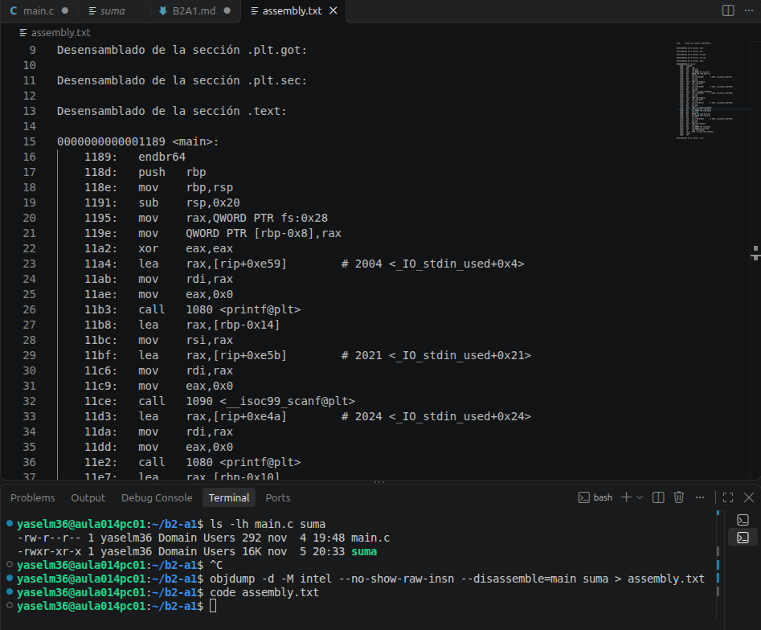

### 7.2. Analizar las instrucciones

En el archivo assembly.txt he buscado diferentes instrucciones del lenguaje ensamblador.

1. Instrucción MOV

La instrucción mov permite mover datos entre registros o entre registros y memoria.

Dirección: 1202

Instrucción: mov

Operandos: edx, DWORD PTR [rbp-0x14]

2. Instrucción add

Dirección : 1208

Instrucción : add

Operandos : eax,edx

3. Instrucción call

Dirección : 11b3

Instrucción : call

Operandos : 1080 <printf@plt>

Y qui tenemos la captura de assembly.txt : 

## 8. Examinar el código máquina 

### 8.1. Extraer el código máquina

He utilizado el comando objcopy para extraer los bytes de la sección .text del ejecutable suma.

El resultado se ha guardado en el archivo binario machine-code.bin.

### 8.2. Convertir los bytes a hexadecimal

He utilizado el comando `xxd -g 1 para visualizar el contenido del archivo binario en formato hexadecimal`.

El archivo machine-code.txt muestra tres columnas:

    Desplazamiento: posición de los bytes dentro del archivo.

    Hexadecimal: representación hexadecimal de los bytes.

    Texto: representación de los bytes como caracteres cuando es posible.

### 8.3. Relacionar el ensamblador con el código máquina

He utilizado objdump para mostrar las instrucciones ensamblador junto con sus bytes correspondientes en código máquina.

Por ejemplo, la instrucción add eax, 3 puede representarse mediante los bytes 83 c0 03 en arquitectura x86.

Esto permite observar la relación entre las instrucciones simbólicas del ensamblador y su representación en código máquina.

capturas de `machine-code.txt` y `machine-code-and-assembly.txt` : 

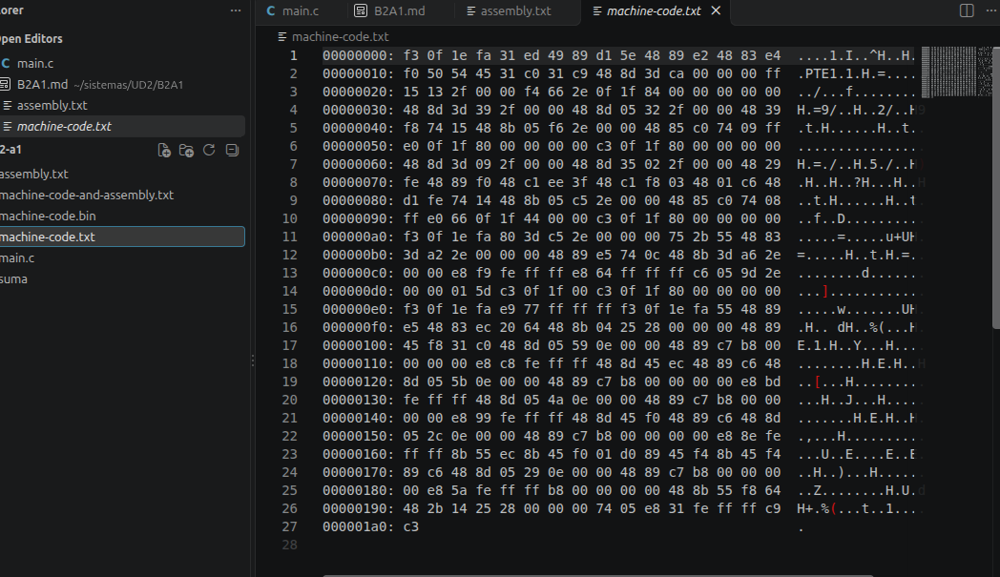 
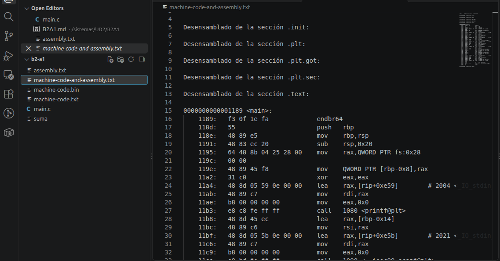

## 9. Evolución de los lenguajes de programación 

### 9.1. Código máquina

El código máquina es el lenguaje que entiende directamente el procesador. Está formado por bits (0 y 1) que representan las instrucciones que debe ejecutar.

Su principal desventaja es que resulta difícil de leer, escribir y comprender para las personas.

### 9.2. Lenguaje ensamblador

El lenguaje ensamblador permitió sustituir los códigos numéricos por instrucciones simbólicas como `mov`, `add` y `jmp`.

Esto facilitó la lectura y escritura de programas, aunque sigue dependiendo de la arquitectura del procesador.

### 9.3. Lenguaje C

El lenguaje C es un lenguaje de programación de alto nivel que permite escribir instrucciones de una forma más sencilla y comprensible.

Por ejemplo:

`int suma = 5 + 3;`

El compilador transforma el código fuente en instrucciones que puede ejecutar el procesador, sin que el programador tenga que controlar directamente los registros.

### 9.4. Comprobar las diferencias (Opcional)

He modificado el programa original para sustituir la operación de suma por una operación de multiplicación.

Después, he compilado el programa con GCC y lo he ejecutado para comprobar que funciona correctamente.

Al examinar el código ensamblador, podemos observar que la operación de suma utiliza una instrucción como `add`, mientras que la multiplicación puede utilizar `imul`.

De esta manera, podemos comprobar cómo un cambio en el código C produce cambios en las instrucciones ensamblador y en el código máquina.

### Paso 9.5. Comparar los resultados

| Operación en C | Instrucción en ensamblador | Operandos |
|---|---|---|
| `num1 + num2` | `add` | `eax, edx` |
| `num1 * num2` | `amul` | `eax,edx`|

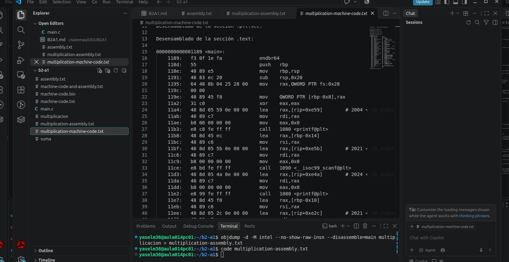

### 9.5. Comparación final

Después de comparar las operaciones de suma y multiplicación, podemos observar las siguientes diferencias:

- **Código C:** La suma utiliza el operador `+`, mientras que la multiplicación utiliza el operador `*`.
- **Lenguaje ensamblador:** La suma se representa mediante la instrucción `add` y la multiplicación mediante la instrucción `imul`.
- **Código máquina:** Cada instrucción tiene una representación hexadecimal diferente.

En conclusión, un pequeño cambio en el código fuente puede producir cambios en las instrucciones ensambladoras y en el código máquina generado por el compilador.