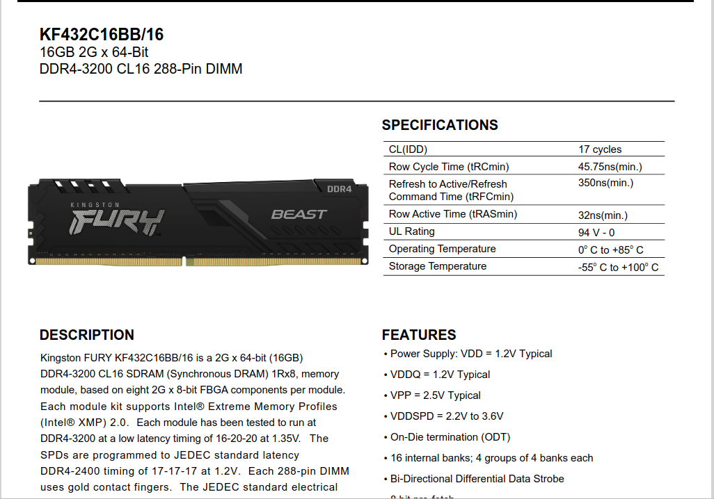
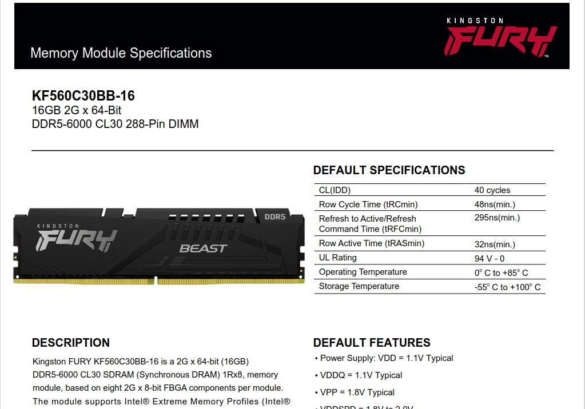

 Enlace de github pages :  [https://yassineelmir10.github.io/YassineElmir-docs/](https://yassineelmir10.github.io/YassineElmir-docs/)    

[Volver ](../index2.md) 

# A3. Análisis y comparación de memorias RAM 

## 1. Selección de memorias RAM 

**Buscamos en las páginas oficiales de los fabricantes dos módulos de memoria RAM comerciales, uno DDR4 y otro DDR5.**

| Característica | DDR4 | DDR5 |
|---|---|---|
| Fabricante | Kingston | Kingston |
| Modelo | KF432C16BB/16 | KF560C30BB-16 |
| Capacidad | 16 GB | 16 GB |
| Velocidad | 3200 MT/s | 6000 MT/s |
| Latencia CAS | CL16 | CL30 |
| Formato | DIMM, 288 pines | DIMM, 288 pines |
| Voltaje estándar | 1,2 V | 1,1 V |
| Voltaje con XMP | 1,35 V | 1,4 V |
| Perfil | Intel XMP 2.0 | Intel XMP 3.0 |
| Precio | 211 € | 415 € |

[ Enlace de DDR4 : ](https://www.kingston.com/datasheets/KF432C16BB_16.pdf?utm_source=chatgpt.com)

**Captura :**  
**KF432C16BB/16**   
**16GB 2G x 64-Bit**  
**DDR4-3200 CL16 288-Pin DIMM**   

**Captura :**  
**KF560C30BB-16**   
**16GB 2G x 64-Bit**   
**DDR5-6000 CL30 288-Pin DIMM**   

## 2. Comparación de características 

La memoria DDR5 ofrece una velocidad de transferencia superior a la DDR4: 6000 MT/s frente a 3200 MT/s.

**Cálculo de la latencia DDR4:**

Latencia = (16 × 2000) / 3200 = **10 ns**

**Cálculo de la latencia DDR5:**

Latencia = (30 × 2000) / 6000 = **10 ns**

**Conclusiones:**

1. La memoria DDR5 ofrece una mayor velocidad de transferencia.
2. Ambas memorias presentan la misma latencia CAS aproximada: 10 ns.
3. Las dos memorias tienen la misma capacidad: 16 GB.
4. Según los precios consultados, la DDR4 cuesta 211 € y la DDR5 415 €.

En conclusión, la DDR5 ofrece una mayor velocidad de transferencia, mientras que ambas memorias presentan la misma latencia CAS calculada mediante la fórmula estudiada.

[Volver ](../index2.md) 
