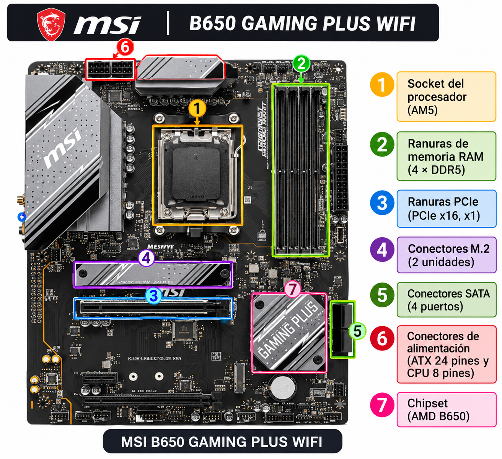
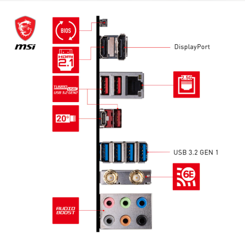
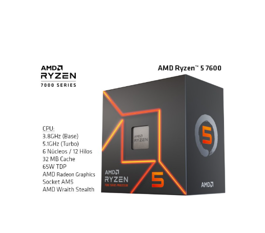
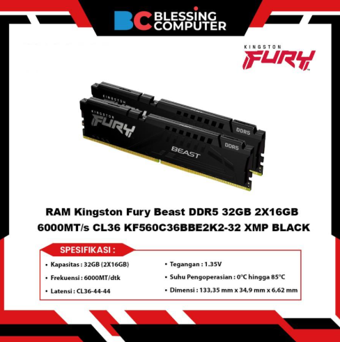
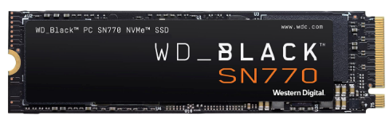

 Enlace de github pages :  [https://yassineelmir10.github.io/YassineElmir-docs/](https://yassineelmir10.github.io/YassineElmir-docs/)    

[Volver ](../index2.md) 

# A4. Análisis de una placa base comercial

## 1. Selección e identificación

### Placa base seleccionada

**MSI B650 GAMING PLUS WIFI**

| Característica | Valor |
|---|---|
| Fabricante y modelo | MSI B650 GAMING PLUS WIFI |
| Factor de forma | ATX (243,84 × 304,8 mm) |
| Chipset | AMD B650 |
| Socket | AMD AM5 |
| Tecnología de memoria RAM | DDR5 |
| Número de ranuras DIMM | 4 |
| Página oficial | https://www.msi.com/Motherboard/B650-GAMING-PLUS-WIFI |

### Imagen e identificación de los componentes

Imagen oficial: 

| Número | Componente | Ubicación |
|---|---|---|
| 1 | Socket del procesador | Zona superior central |
| 2 | Ranuras de memoria RAM | Zona derecha del socket |
| 3 | Ranuras PCIe | Zona inferior central |
| 4 | Conectores M.2 | Zona central de la placa |
| 5 | Conectores SATA | Borde derecho |
| 6 | Conectores de alimentación ATX y CPU | Zona derecha y superior izquierda |
| 7 | Chipset AMD B650 | Zona inferior derecha |

## 2. Conectores y ranuras

### 2.1. Conectores internos

| Elemento | Cantidad |
|---|---:|
| Ranuras PCIe | 3 |
| Conectores M.2 | 2 |
| Conectores SATA | 4 |
| Conectores USB internos | 4 |

**Detalles:**

- PCIe: 2 ranuras PCIe x16 y 1 ranura PCIe x1.
- M.2: 2 conectores PCIe 4.0 x4.
- SATA: 4 conectores SATA de 6 Gb/s.
- USB internos: 2 conectores USB 2.0, 1 conector USB 5 Gb/s y 1 conector USB Type-C de 10 Gb/s.

**La Captura :** 

### 2.2. Conectores externos (panel trasero)

| Tipo de conector | Cantidad |
|---|---:|
| USB 3.2 Gen 2 Type-A (10 Gb/s) | 3 |
| USB 3.2 Gen 1 Type-A (5 Gb/s) | 4 |
| USB 3.2 Gen 2x2 Type-C (20 Gb/s) | 1 |
| HDMI 2.1 | 1 |
| DisplayPort 1.4 | 1 |
| Ethernet RJ-45 2.5G | 1 |
| Conectores de audio Jack 3,5 mm | 6 |
| Conectores de antena Wi-Fi | 2 |
| Botón Flash BIOS | 1 |

**Total de puertos USB traseros: 8.**

### 2.3. Documentación de los conectores

- [Especificaciones oficiales MSI](https://www.msi.com/Motherboard/B650-GAMING-PLUS-WIFI/Specification)
- [Manual oficial de MSI (PDF)](https://download.msi.com/archive/mnu_exe/mb/B650GAMINGPLUSWIFI.pdf)
- [Ficha técnica oficial (PDF)](https://storage-asset.msi.com/datasheet/mb/global/B650-GAMING-PLUS-WIFI.pdf)

## 3. Compatibilidad de componentes

### 3.1. Procesador

**AMD Ryzen 5 7600**

| Característica | Especificación |
|---|---|
| Fabricante | AMD |
| Modelo | Ryzen 5 7600 |
| Núcleos | 6 |
| Hilos | 12 |
| Socket | AM5 |
| Arquitectura | Zen 4 |
| Frecuencia máxima | 5,1 GHz |
| TDP | 65 W |

**Comprobación de compatibilidad:**

Es compatible porque la placa base dispone de socket AM5 y admite procesadores AMD Ryzen de la serie 7000.

Enlace: [AMD Ryzen 5 7600](https://www.amd.com/en/products/processors/desktops/ryzen/7000-series/amd-ryzen-5-7600.html)  
**caprura :**  

### 3.2. Memoria RAM

**Kingston FURY Beast DDR5 32 GB (2 × 16 GB)**

| Característica | Especificación |
|---|---|
| Fabricante | Kingston |
| Modelo | FURY Beast DDR5 |
| Capacidad | 32 GB (2 × 16 GB) |
| Tecnología | DDR5 |
| Velocidad | 6000 MT/s |
| Latencia | CL36 |
| Perfil | AMD EXPO |
| Referencia | KF560C36BBE2K2-32 |

**Comprobación de compatibilidad:**

Es compatible porque la placa base dispone de cuatro ranuras DDR5 y admite módulos de memoria DDR5 con velocidades de hasta 6000 MT/s mediante overclocking (OC).

Enlace: [Kingston FURY Beast DDR5](https://www.kingston.com/es/memory/search?partId=KF560C36BBE2K2-32)

**Caprura :**   

### 3.3. SSD M.2 NVMe

**WD_BLACK SN770 1 TB**

| Característica | Especificación |
|---|---|
| Fabricante | Western Digital |
| Modelo | WD_BLACK SN770 |
| Capacidad | 1 TB |
| Formato | M.2 2280 |
| Interfaz | PCIe 4.0 x4 |
| Tecnología | NVMe |

**Comprobación de compatibilidad:**

Es compatible porque la placa base dispone de dos conectores M.2 PCIe 4.0 x4 y admite unidades SSD con formato M.2 2280.

Enlace: [WD_BLACK SN770](https://www.westerndigital.com/products/internal-drives/wd-black-sn770-nvme-ssd)       
**Caprtura :**   

### 3.4. Tabla de compatibilidad

| Componente | Fabricante y modelo | Característica que determina su compatibilidad |
|---|---|---|
| Procesador | AMD Ryzen 5 7600 | Socket AM5 y compatibilidad con Ryzen serie 7000 |
| Memoria RAM | Kingston FURY Beast DDR5 32 GB (2 × 16 GB) | DDR5, 6000 MT/s y AMD EXPO |
| SSD M.2 NVMe | WD_BLACK SN770 1 TB | M.2 2280, PCIe 4.0 x4 y NVMe |

**Resultado:** Los tres componentes cumplen las características técnicas necesarias para funcionar con la placa base MSI B650 GAMING PLUS WIFI.

## 4. Documentación consultada

| Documentación | Enlace |
|---|---|
| Especificaciones de la placa base | [MSI Specifications](https://www.msi.com/Motherboard/B650-GAMING-PLUS-WIFI/Specification) |
| Manual de la placa base | [MSI User Manual (PDF)](https://download.msi.com/archive/mnu_exe/mb/B650GAMINGPLUSWIFI.pdf) |
| Lista de procesadores compatibles | [MSI Support](https://www.msi.com/Motherboard/B650-GAMING-PLUS-WIFI/support) |
| Especificaciones del procesador | [AMD Ryzen 5 7600](https://www.amd.com/en/products/processors/desktops/ryzen/7000-series/amd-ryzen-5-7600.html) |
| Especificaciones de la RAM | [Kingston FURY Beast DDR5](https://www.kingston.com/es/memory/search?partId=KF560C36BBE2K2-32) |
| Especificaciones del SSD | [WD_BLACK SN770](https://www.westerndigital.com/products/internal-drives/wd-black-sn770-nvme-ssd) |

## Conclusión

La placa base MSI B650 GAMING PLUS WIFI permite montar un equipo basado en procesadores AMD Ryzen con socket AM5, memoria DDR5 y almacenamiento SSD M.2 NVMe.

Los componentes seleccionados cumplen los requisitos técnicos de socket, memoria e interfaz de almacenamiento de la placa base, por lo que constituyen una configuración compatible.
