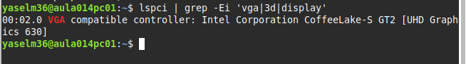
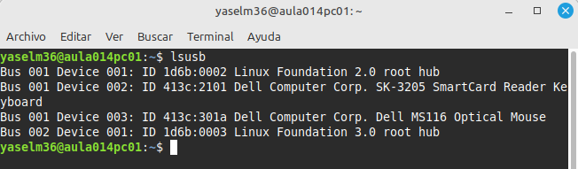
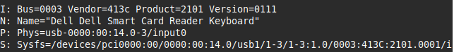
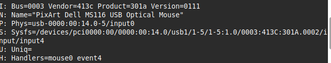
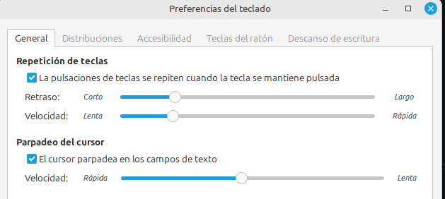
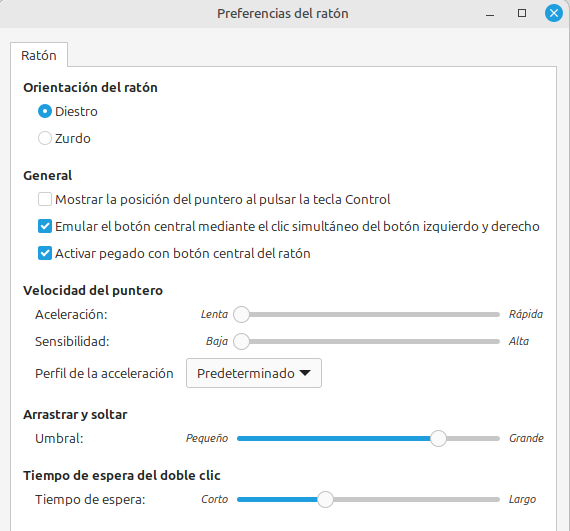
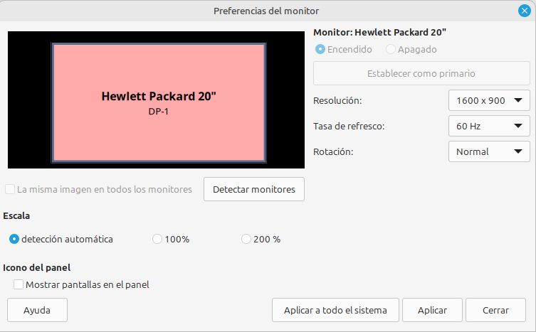

# A5. Análisis de almacenamiento, GPU y periféricos 

## 1. Dispositivos de almacenamiento 

| Dispositivo | Capacidad | Modelo | Tipo de conexión |
|---|---|---|---|
| nvme0n1 | 931,5 GB | WD_BLACK SN770 1TB | NVMe |

Con el comando lsblk no se puede determinar directamente si un dispositivo es HDD o SSD,  
ya que no muestra explícitamente esta característica. Sin embargo, el dispositivo detectado utiliza una conexión NVMe.

**La Captura :**
 

## 2. Tarjeta gráfica (GPU) 

| Característica | Resultado |
|---|---|
| Fabricante | Intel Corporation |
| Modelo | Intel UHD Graphics 630 |
| Integrada o dedicada | Integrada |
| Fuente consultada | [Documentación oficial de Intel](https://www.intel.com/content/www/us/en/support/articles/000005718/processors/intel-core-processors.html) |

**La Captura :**   

## 3. Identificación de periféricos 

| Periférico | Entrada / Salida / Entrada y salida | Interfaz de conexión |
|---|---|---|
| Teclado Dell SK-3205 | Entrada | USB |
| Ratón Dell MS116 | Entrada | USB |
| Monitor | Salida | HDMI / DisplayPort (comprobar conexión) |

Se han identificado mediante el comando `lsusb` un teclado Dell SK-3205 y un ratón óptico Dell MS116.

No todos los periféricos tienen que aparecer en el resultado de `lsusb`, porque algunos dispositivos utilizan otras interfaces de conexión, como HDMI, DisplayPort, PCIe o conexiones internas del ordenador.

**La Captura :**

## 4. Reconocimiento de dispositivos de entrada 

| Dispositivo | Nombre reconocido por Linux |
|---|---|
| Teclado | Dell Dell Smart Card Reader Keyboard |
| Ratón | PixArt Dell MS116 USB Optical Mouse |

**Captura del Teclado :**    
   

**Captura del Raton :**  

## 5. Configuración de periféricos 

| Dispositivo | Dos parámetros configurables y sus valores actuales |
|---|---|
| Teclado | Repetición de teclas: Activada. Retraso: Corto. |
| Ratón | Orientación: Diestro. Sensibilidad: Baja. |
| Monitor | Resolución: 1600 × 900. Tasa de refresco: 60 Hz. |

- **Teclado:** Si aumentamos el retraso de repetición, tendremos que mantener pulsada una tecla durante más tiempo antes de que el carácter empiece a repetirse.

- **Ratón:** Si aumentamos la sensibilidad, el puntero se moverá más rápidamente por la pantalla.

- **Monitor:** Si cambiamos la resolución, modificaremos la cantidad de píxeles que se muestran en la pantalla y el nivel de detalle de la imagen.

**Captura del Teclado :**    
    

**Captura del Raton :**     

**Captura del Monitor :**    

## 6. Conclusiones

### ¿Qué dispositivos has podido identificar directamente desde Linux?

He podido identificar el disco SSD WD_BLACK SN770 de 1 TB, la tarjeta gráfica integrada Intel UHD Graphics 630, el teclado Dell SK-3205 y el ratón Dell MS116. También he podido consultar la configuración del monitor HP de 20 pulgadas.

### ¿Qué información has necesitado consultar en fuentes externas?

He necesitado consultar la documentación oficial de Intel para identificar las características de la tarjeta gráfica Intel UHD Graphics 630 y determinar que es integrada.

### ¿Qué ventajas ofrece Plug and Play para la utilización de periféricos?

Plug and Play permite que el sistema operativo detecte y configure automáticamente los dispositivos conectados, facilitando su utilización sin necesidad de realizar configuraciones manuales complejas.

## Referencias

- [Intel – Identificación de gráficos Intel](https://www.intel.com/content/www/us/en/support/articles/000005718/processors/intel-core-processors.html)
- [Linux Mint – Página oficial](https://linuxmint.com/)
- [Ubuntu – Documentación oficial](https://docs.ubuntu.com/)