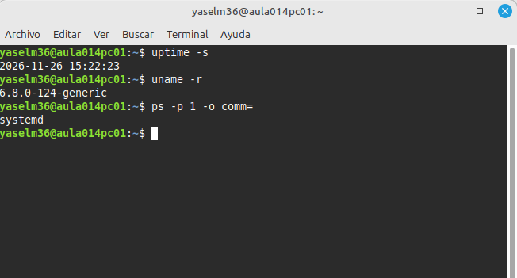

 Enlace de github pages :  [https://yassineelmir10.github.io/YassineElmir-docs/](https://yassineelmir10.github.io/YassineElmir-docs/)    

[Volver ](../index2.md) 

# A6. Comprobación del arranque y seguridad 

## 1. Comprobación del arranque 
# Actividad: Comprobación del arranque y prevención de riesgos

El objetivo de esta actividad es comprobar información sobre la puesta en marcha de un ordenador con Linux mediante diferentes comandos del terminal.

### 1.1. Captura de pantalla

En la siguiente captura se muestran los tres comandos ejecutados y sus resultados.

### 1.2. Resultados obtenidos

| Información | Resultado obtenido |
|---|---|
| Fecha y hora del último arranque | 2026-11-26 15:22:23 |
| Versión del kernel | 6.8.0-124-generic |
| Proceso con PID 1 | systemd |

### 1.3. Preguntas

**1. ¿Cuánto tiempo ha transcurrido aproximadamente desde el último arranque del ordenador?**

Han transcurrido aproximadamente 4 horas y 34 minutos desde el último arranque del ordenador.

**2. ¿Qué función desempeña el proceso con PID 1?**

El proceso con PID 1 (`systemd`) es el primer proceso que inicia Linux. Se encarga de iniciar y gestionar los servicios y procesos del sistema.

**3. ¿Permiten estos comandos comprobar si el POST se ha realizado correctamente? Justifica tu respuesta.**

No. Estos comandos permiten consultar información del sistema operativo, pero no comprobar directamente si el POST se ha realizado correctamente. El POST es una comprobación del hardware que realiza la BIOS o UEFI antes de iniciar el sistema operativo.

---

## 2. Seguridad y prevención de riesgos

En este apartado se analizan diferentes situaciones que pueden producirse en un aula de informática, identificando sus riesgos y las medidas preventivas adecuadas.

| Situación | Riesgo | Medida preventiva |
|---|---|---|
| Un ordenador tiene las rejillas de ventilación obstruidas por objetos. | Sobrecalentamiento del ordenador y posibles daños en los componentes internos. | Mantener las rejillas de ventilación libres de objetos para permitir una correcta circulación del aire. |
| Un cable de alimentación presenta daños visibles en su aislamiento. | Riesgo de descarga eléctrica, cortocircuito o incendio. | No utilizar el cable y comunicar la incidencia al profesor o al responsable de mantenimiento para que sea sustituido. |
| Un alumno trabaja durante varias horas con el monitor demasiado bajo y sin realizar descansos. | Dolor de cuello y espalda, fatiga visual y cansancio físico. | Colocar el monitor a una altura adecuada, mantener una postura correcta y realizar descansos periódicos. |

---

## 3. Conclusiones

**1. ¿Qué información sobre el arranque has podido comprobar desde Linux?**

He podido comprobar la fecha y hora del último arranque, la versión del kernel y el proceso que tiene el PID 1.

**2. ¿Qué comprobaciones del arranque no has podido observar directamente?**

No he podido observar directamente las comprobaciones POST realizadas por la BIOS o UEFI, ni verificar físicamente el estado de todos los componentes del hardware.

**3. ¿Por qué es importante aplicar medidas de prevención de riesgos en un aula de informática?**

Es importante para proteger la salud y seguridad de las personas, evitar accidentes, prevenir daños en los equipos y mantener un entorno de trabajo seguro.

[Volver ](../index2.md) 