[Volver ](../index2.md)

# 1. Catálogo de procesadores Intel

## 1.1. Familias, gamas y modelos

1.  ¿Cuál de los tres modelos tiene más núcleos?
- El modelo con más núcleos es el Intel Core Ultra 9 285K, con 24 núcleos.

2.  ¿Cuál dispone de mayor memoria caché?
- El modelo con mayor memoria caché es también el Intel Core Ultra 9 285K, con 36 MB.

3.  ¿Por qué no basta con conocer la denominación comercial para saber cuántos núcleos tiene un procesador?
- No basta con conocer la denominación comercial porque el número de la gama (5, 7 o 9) no indica directamente la cantidad de núcleos, la frecuencia ni la memoria caché. Es necesario consultar las especificaciones técnicas.

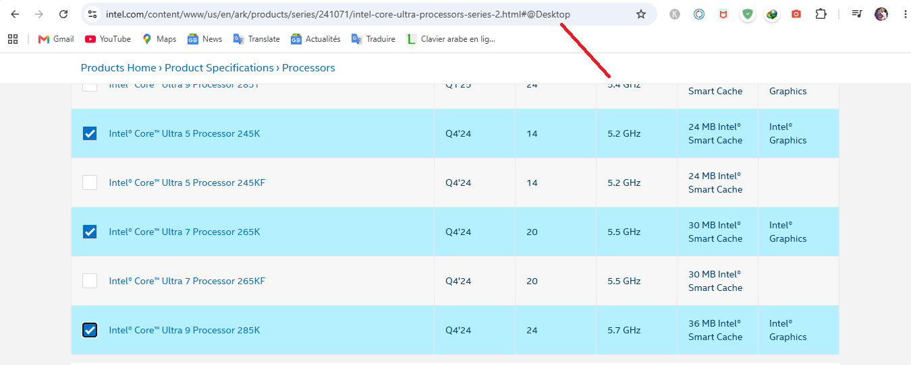
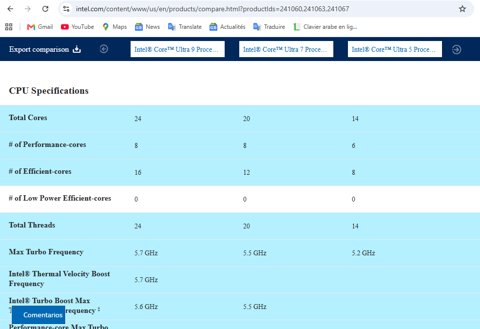
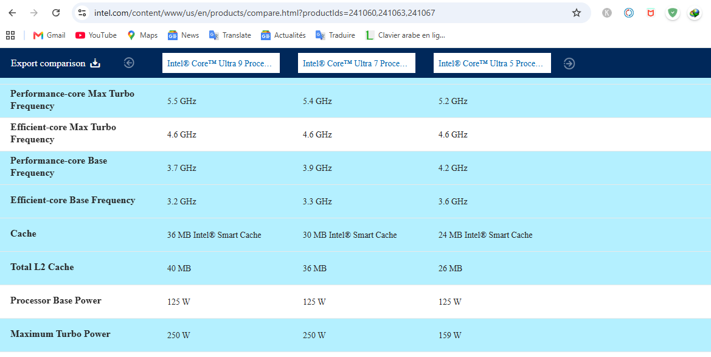

## 1.2. Sufijos comerciales y gráficos integrados

1. ¿Qué variantes carecen de GPU integrada activa?
- Las variantes que carecen de GPU integrada activa son la 265F y la 265KF.

2. ¿Qué variantes tienen el multiplicador desbloqueado?
- Las variantes que tienen el multiplicador desbloqueado son la 265K y la 265KF.

3. ¿Qué inconveniente práctico tendría elegir un modelo F si no disponemos de tarjeta gráfica dedicada?

- El inconveniente de elegir un modelo F sin una tarjeta gráfica dedicada es que no podremos obtener imagen en el equipo, ya que el procesador no dispone de gráficos integrados activos.

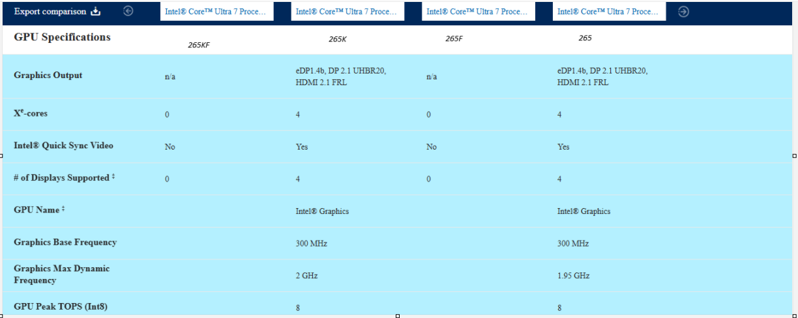

## 1.3. Fechas de lanzamiento y evolución de las gamas

**¿Cuál tiene más núcleos y cuál dispone de mayor caché?**

- El Intel Core Ultra 7 270K Plus tiene más núcleos, con 24 frente a los 18 del Core Ultra 5 250K Plus. También dispone de mayor memoria caché, con 36 MB frente a 30 MB.

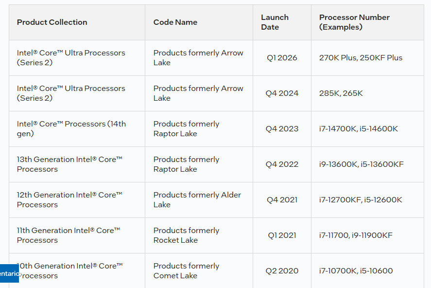
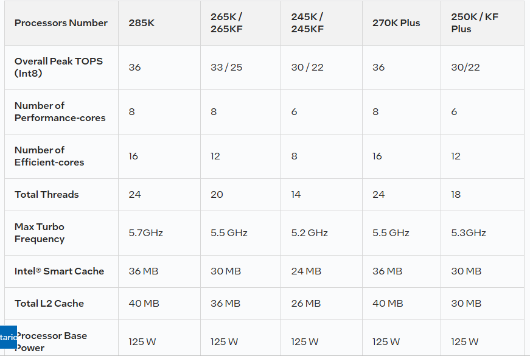

# 2. Ficha técnica del Intel Core Ultra 7 265

## 2.1. Identificación, segmento y fecha

**¿Cuál es su nombre en clave, para qué segmento está diseñado y cuándo se lanzó?**
- Nombre en clave: **Arrow Lake**.
- Segmento: **Desktop (ordenadores de sobremesa)**.
- Fecha de lanzamiento: **Q1 2025**.

Mira las capturas : 

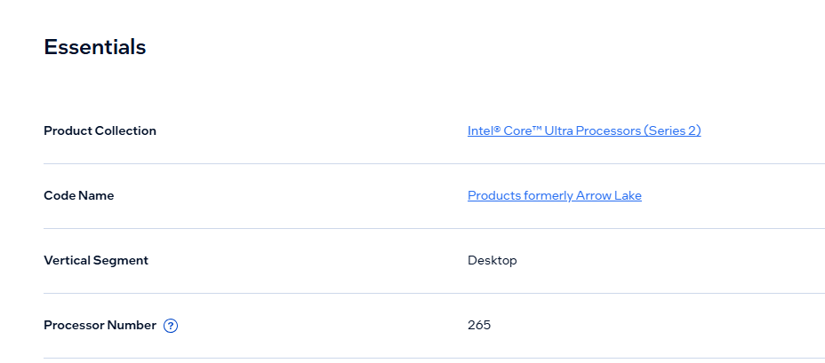
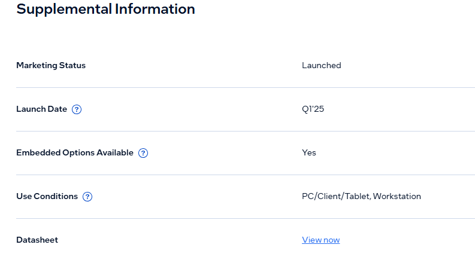

## 2.2. Núcleos de rendimiento, núcleos de eficiencia e hilos

1. ¿Cuántos P-cores y E-cores tiene? ¿Cuántos núcleos suma?
- Tiene 8 P-cores y 12 E-cores, por lo que suma un total de 20 núcleos.

2. ¿Cuántos hilos hardware anuncia?
- Anuncia 20 hilos hardware.

3. ¿Dispone de Hyper-Threading?
- No dispone de Intel Hyper-Threading Technology.

**Mira los Capturas :**

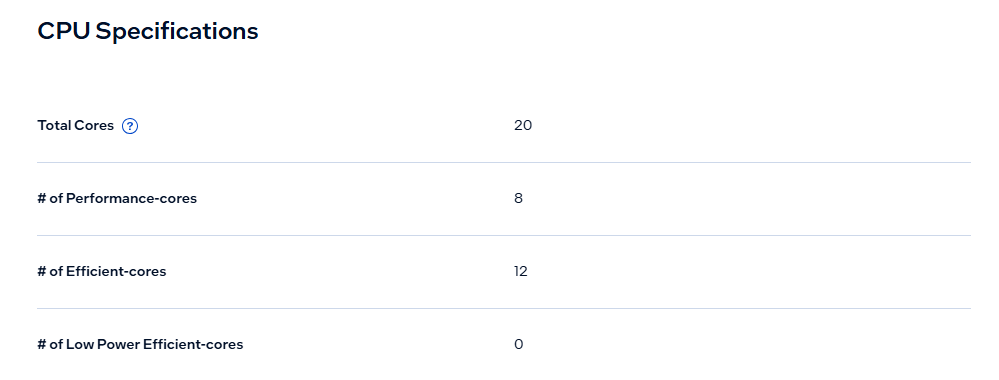
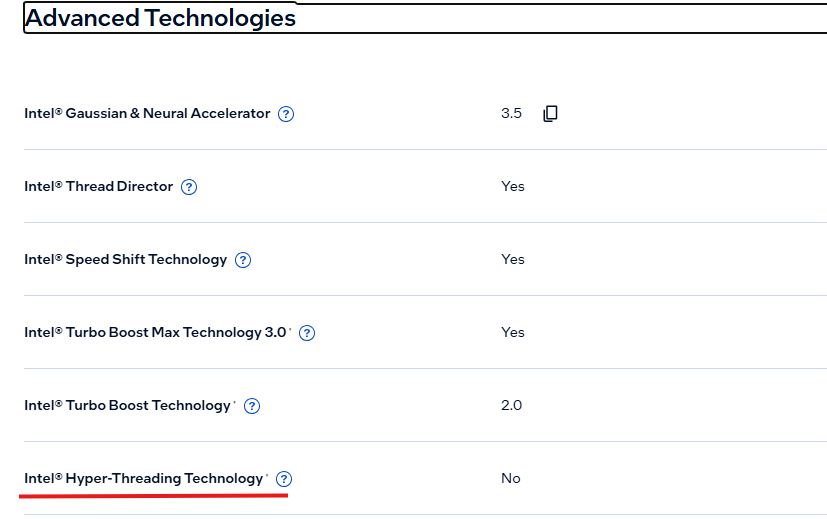

## 2.3. Frecuencia base, turbo y rendimiento

- Max Turbo Frequency: 5,3 GHz.
- Performance-core Max Turbo Frequency: 5,2 GHz.
- Efficient-core Max Turbo Frequency: 4,6 GHz.
- Performance-core Base Frequency: 2,4 GHz.
- Efficient-core Base Frequency: 1,8 GHz.

- El tipo de núcleo que alcanza mayor frecuencia turbo es el P-core, con 5,2 GHz.

- No es correcto interpretar la frecuencia turbo máxima como una velocidad constante de todos los núcleos, porque depende de la carga de trabajo, el consumo y la temperatura.

**Caprura de los Frecuencias de los P-cores y E-cores :**
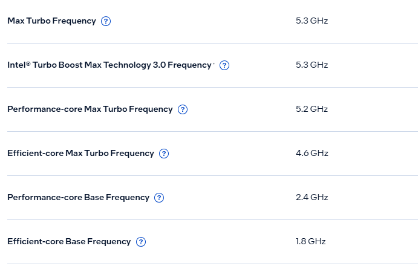

## 2.4. Memoria caché L2 y L3

 **¿Qué capacidad indica Intel para Smart Cache y cuál para la caché L2 total?**

- Intel Smart Cache (L3): 30 MB.
- Total L2 Cache: 36 MB.

## 2.5. Potencia, refrigeración y temperatura

 **¿Cuál es la potencia base, cuál es la potencia turbo máxima y qué temperatura máxima indica la ficha? :**

- Processor Base Power: 65 W.
- Maximum Turbo Power: 182 W.
- Max Operating Temperature: 105 °C.
Mira los Capturas :

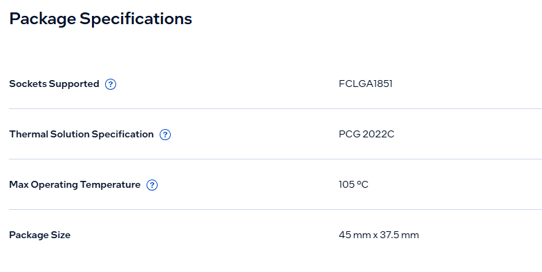

## 2.6. Memoria RAM, canales y ECC

**¿Qué tipo de RAM admite, qué capacidad máxima indica y cuántos canales de memoria soporta? :**

- Tipo de memoria: DDR5 hasta 6400 MT/s.
- Capacidad máxima: 256 GB.
- Número máximo de canales: 2.
- ECC Memory Supported: Sí.
La Captura :

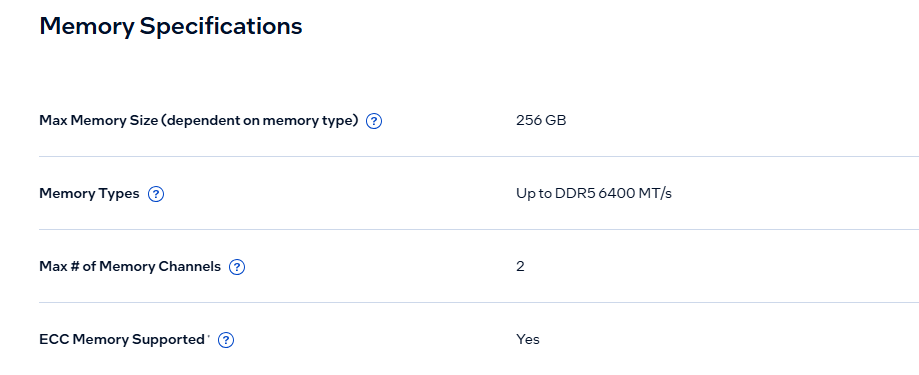

## 2.7. Gráficos integrados y NPU

 **¿Qué GPU incorpora, cuántas pantallas admite y qué rendimiento TOPS anuncia la NPU?**
- GPU: Intel Graphics.
- Graphics Max Dynamic Frequency: 1,95 GHz.
- Xe-cores: 4.
- Número máximo de pantallas: 4.
- NPU: Intel AI Boost.
- NPU Peak TOPS: 13 TOPS.

**Captura de la GPU :**

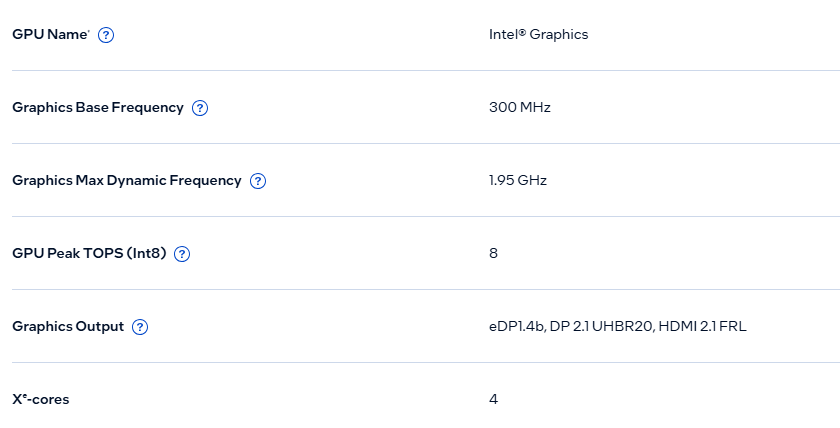

**Captura de la NPU :**

## 2.8. PCI Express, socket y virtualización

 **¿Qué versiones de PCIe admite, qué socket utiliza y es compatible con VT-x y VT-d?**
- PCI Express: PCIe 5.0 y PCIe 4.0.
- Máximo de líneas PCIe: 24.
- Socket: FCLGA1851 (LGA 1851).
- Intel VT-x: Sí.
- Intel VT-d: Sí.

**Captura de Expansion Options :**
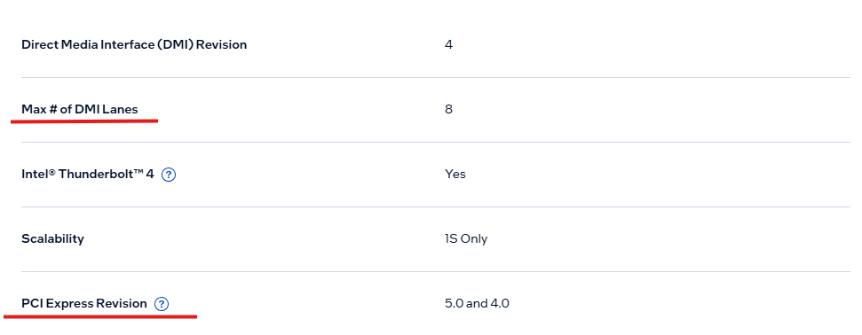

**Captura de Package Specifications :**

**Captura de Security & Reliability :**

[Volver ](../index2.md)
