[Volver ](../index2.md)

[github pages link](https://yassineelmir10.github.io/YassineElmir-docs/)

# 3. Catálogo de procesadores AMD

## 3.1. Series Ryzen y denominaciones comerciales

| **Modelo** | **Gama** | **Núcleos** | **Hilos** |
| --- | --- | --- | ---: |
| Ryzen 5 9600X | Ryzen 5 | 6 | 12 |
| Ryzen 7 9700X | Ryzen 7 | 8 | 16 |
| Ryzen 9 9950X | Ryzen 9 | 16 | 32 |

La gama que presenta el mayor número de núcleos, entre los modelos observados, es Ryzen 9, con 16 núcleos en el Ryzen 9 9950X.

**Ryzen 5 Captura:**
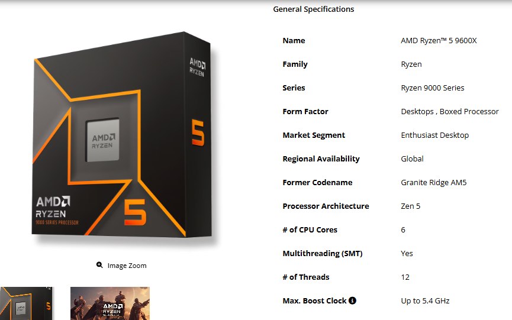

**Ryzen 7 Captura:**
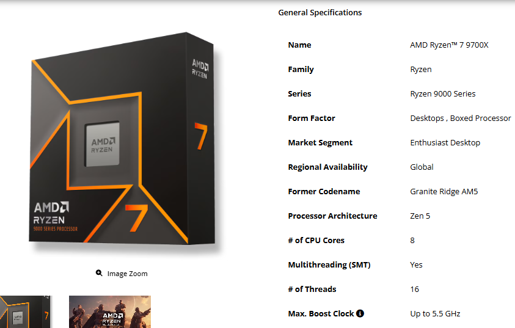

**Ryzen 9 Captura:**
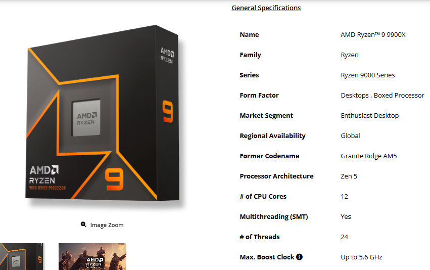

## 3.2. Modelos G y X3D

1. **¿Para qué tipo de equipo puede resultar especialmente interesante un Ryzen G?**

Un procesador Ryzen G resulta especialmente interesante para equipos que no disponen de una tarjeta gráfica dedicada, ya que incorpora una GPU integrada AMD Radeon que permite realizar tareas habituales y ejecutar algunos videojuegos.

2. **¿Qué memoria aumenta la tecnología 3D V-Cache?**

La tecnología AMD 3D V-Cache aumenta la capacidad de la memoria caché L3 mediante el apilamiento vertical de chips de memoria.

**captura Ryzen Serie G :**

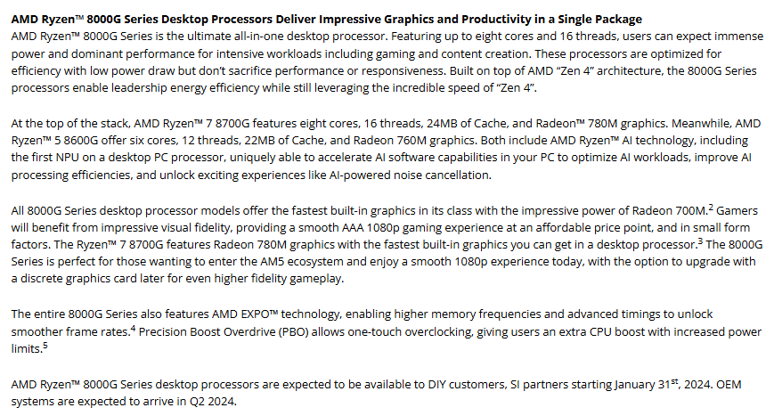

**captura AMD 3D V-Cache :** 

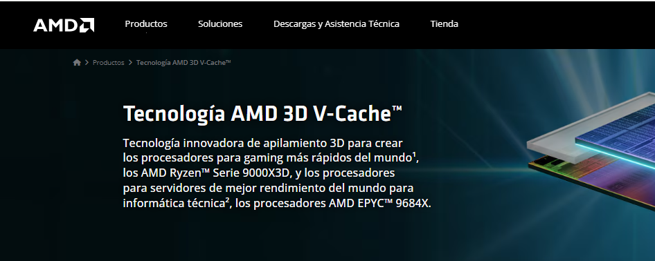

**Captura Ryzen Serie 8000 :**

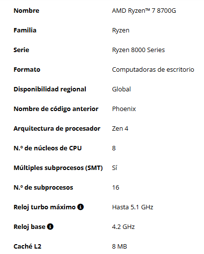

## 3.3. Arquitectura Zen y tecnologías de memoria

**¿Qué componente del ordenador se configura mediante AMD EXPO?**

AMD EXPO permite configurar la memoria RAM, aplicando perfiles compatibles que pueden modificar su frecuencia y sus latencias.

El Ryzen 7 9700X utiliza la arquitectura Zen 5.

**Captura Zen 5 :**

**Captura AMD EXPO :**

# 4. Ficha técnica del AMD Ryzen 7 9700X

## 4.1. Arquitectura, núcleos y SMT

**¿Qué arquitectura utiliza, cuántos núcleos físicos tiene y cuántos hilos hardware puede ejecutar?**

- Familia: Ryzen.
- Serie: Ryzen 9000 Series.
- Arquitectura: Zen 5.
- Número de núcleos físicos: 8.
- SMT: Sí.
- Número de hilos: 16.
- Fecha de lanzamiento: 08/08/2024.

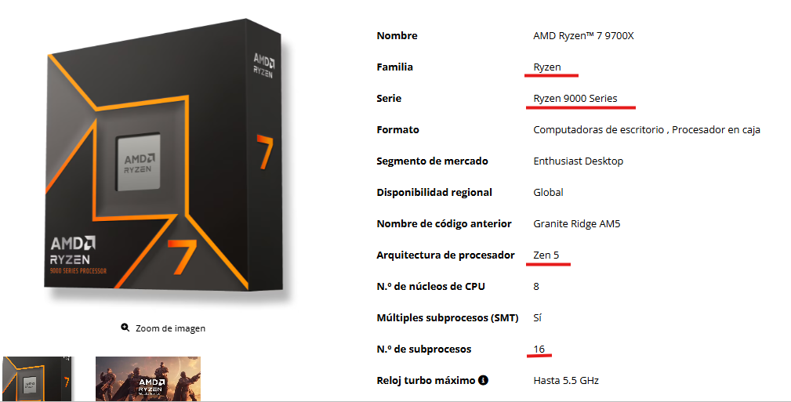

## 4.2. Frecuencias y tres niveles de caché

**¿Cuál es su frecuencia turbo máxima y cuánta caché L2 y L3 tiene?**

- Reloj base: 3,8 GHz.
- Reloj turbo máximo: Hasta 5,5 GHz.
- Caché L1: 640 KB.
- Caché L2: 8 MB.
- Caché L3: 32 MB.
- La frecuencia turbo máxima es de 5,5 GHz. La caché L2 tiene una capacidad de 8 MB y la caché L3 tiene 32 MB.

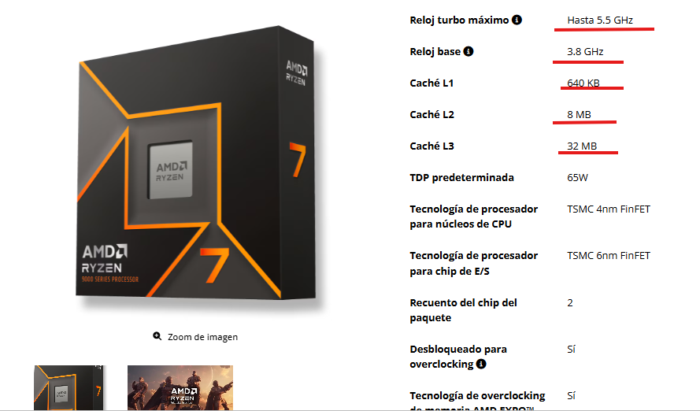

## 4.3. TDP, temperatura y refrigeración

- TDP predeterminada: 65 W.
- Temperatura máxima (Tjmax): 95 °C.
- Solución térmica incluida: No.
- Refrigeración recomendada: Premium air cooler.

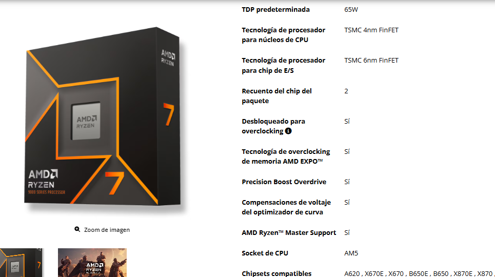
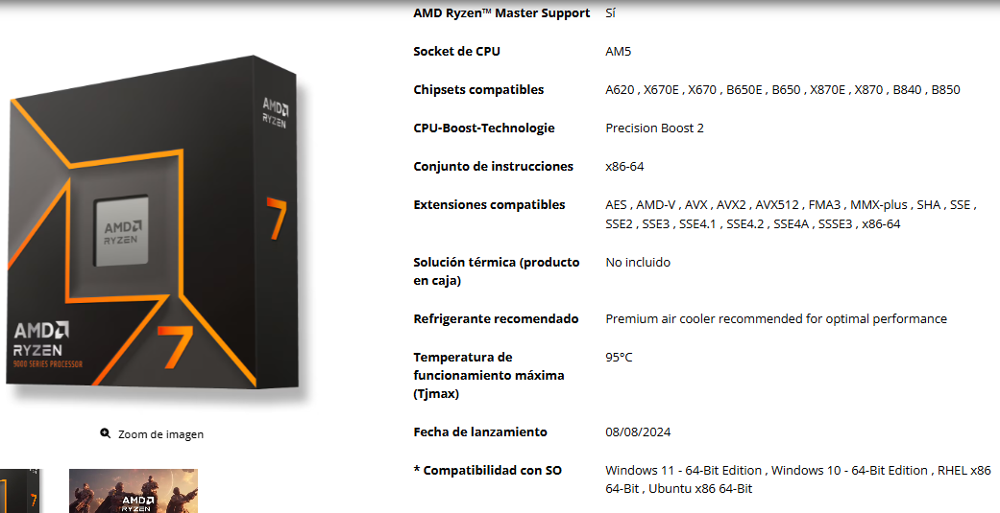

## 4.4. Socket, placa base y overclocking

**¿Qué socket utiliza, admite overclocking y es compatible con AMD-V?**

- Socket: AM5.
- Chipsets compatibles: A620, X670E, X670, B650E, B650, X870E, X870, B840 y B850.
- Desbloqueado para overclocking: Sí.
- Conjunto de instrucciones: x86-64.
- AMD-V: Sí, es compatible.

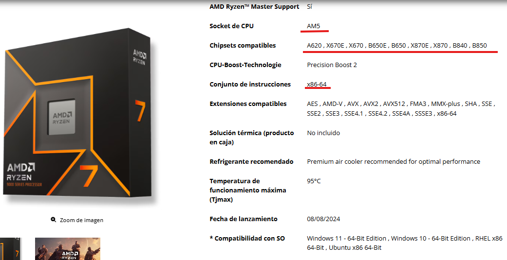

## 4.5. PCI Express y memoria RAM

**Qué versión de PCIe admite, qué capacidad máxima de RAM indica y qué velocidad aparece para la** **configuración 2x1R?**

- Versión PCI Express: PCIe 5.0.
- Carriles PCIe nativos (totales/utilizables): 28 / 24.
- Tipo de memoria: DDR5.
- Canales de memoria: 2.
- Memoria máxima: 256 GB.
- Velocidad máxima para 2x1R: DDR5-5600.
- Compatibilidad ECC: Sí, requiere compatibilidad de la placa base.

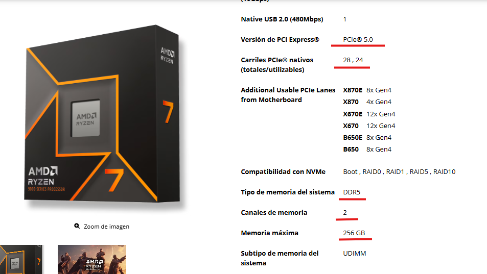

## 4.6. Gráficos integrados

**¿Qué GPU incorpora el Ryzen 7 9700X y cuántos núcleos gráficos tiene?**

- Modelo de tarjeta gráfica: AMD Radeon Graphics.
- Número de núcleos gráficos: 2.
- Frecuencia gráfica: 2200 MHz.

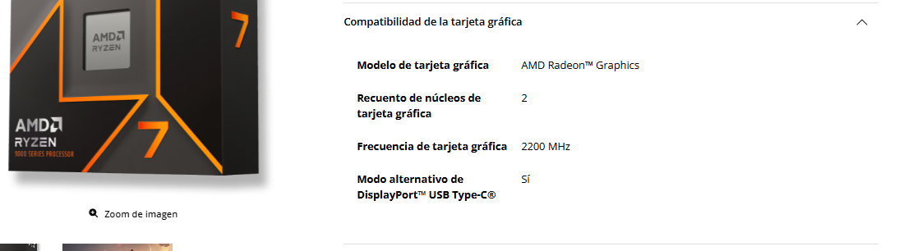

[Volver ](../index2.md)